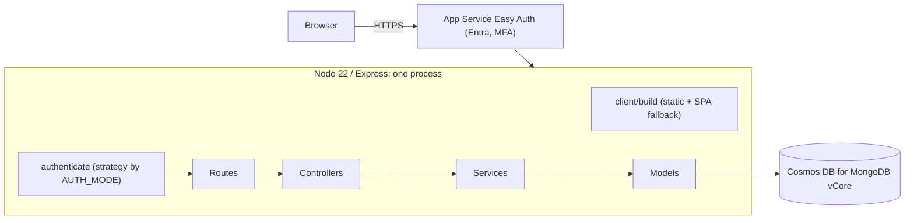
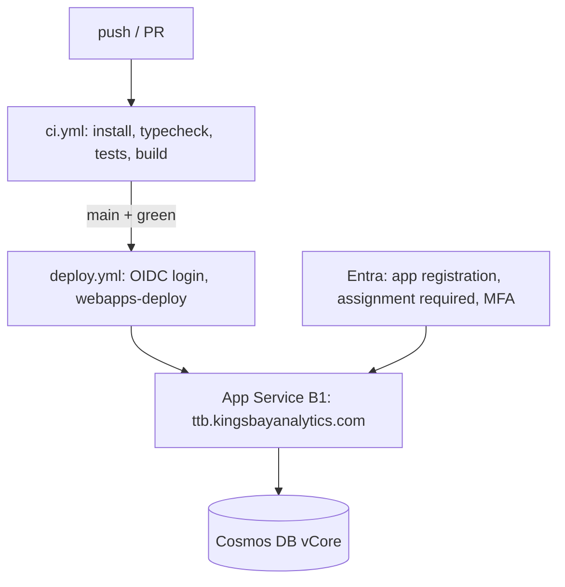
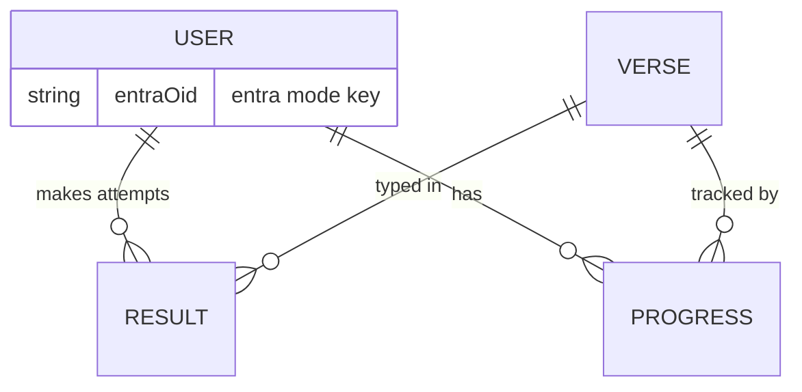

# Architecture Spine — Typing the Bible

## Design Paradigm

Brownfield: ratify what exists (Express routes → controllers → Mongoose models; React components → `services/api.ts`) and add one layer, **services**, for logic that must be unit-testable (stats). One deployable process serves the API and the built client. Auth is a strategy chosen once at the edge.



Dependency direction: `routes → controllers → services → models`; `config` and `utils` are leaf modules importable from anywhere; models never import services; nothing outside `config` reads `process.env`.

## Invariants & Rules

### AD-1 — One origin, one deployable
- **Binds:** CAP-6, CAP-7, FR-7, FR-11
- **Prevents:** a split client/API deployment that reintroduces CORS, token handling, and two release paths.
- **Rule:** In production Express serves `/api/*` and `client/build` (SPA fallback to `index.html` for non-`/api` GETs). The client calls relative `/api`. No static serving of the repo root. `REACT_APP_API_URL` exists only for local dev.

### AD-2 — Authentication is a strategy; controllers see only `req.user`
- **Binds:** CAP-3, CAP-7, FR-6
- **Prevents:** controllers or tests branching on auth mode; production trusting spoofable headers; the `fallback_secret` JWT default.
- **Rule:** A single `authenticate` middleware, chosen by `AUTH_MODE` (`local` | `entra`), sets `req.user`. `local` = existing JWT. `entra` = read `X-MS-CLIENT-PRINCIPAL-ID` (Entra object id) and `-NAME`; require `oid === OWNER_OID` else 403; upsert one `User` keyed by `entraOid`. Boot fails if `AUTH_MODE=entra` and `WEBSITE_AUTH_ENABLED` ≠ `True`, or if production has no `JWT_SECRET` in `local` mode. `entra` mode ignores `Authorization` headers. Registration routes return 404 in `entra` mode.

### AD-3 — Stats are derived on read from `Result`; no stored counters
- **Binds:** CAP-2, FR-3, FR-4, FR-5
- **Prevents:** two sources of truth drifting (counters vs. history); stats logic buried in controllers where it cannot be unit-tested.
- **Rule:** `server/src/services/stats/` exports pure functions over plain rows (`buildTrend`, `buildActivity`, `buildCoverage`); controllers only fetch rows (`Result` by user/date range, `Progress` completed verse ids, `Verse` book index) and call them. Day bucketing uses a client-supplied IANA timezone (`tz`), default `UTC`, never server local time. No schema change to `Result`; `Progress` stays per-verse best state.

### AD-4 — Database portability subset
- **Binds:** CAP-6, FR-11
- **Prevents:** code that works on local MongoDB but breaks on Cosmos DB for MongoDB (vCore) or Atlas.
- **Rule:** Only `MONGODB_URI` selects the database. Use CRUD, indexes, and aggregation stages `$match/$group/$sort/$project/$lookup/$limit` only; no transactions, `$function`, change streams, or server-side JS. Indexes are declared in schemas and created by `npm run db:init` (not at runtime). The verse import (`npm run import-data`) batches inserts, is idempotent (upsert on `verseOrder`), and retries on throttling.

### AD-5 — One validated config module
- **Binds:** CAP-7, CAP-6, FR-7
- **Prevents:** scattered `process.env` reads and silent defaults reaching production.
- **Rule:** `server/src/config.ts` parses and validates env at import with plain checks and exports a typed object; the server exits at boot on any missing/invalid required value. Secrets come only from App Service settings (Key Vault references allowed). `.env*` files are never committed.

### AD-6 — Tests own their database and speak the service boundary
- **Binds:** CAP-3, CAP-4, FR-9
- **Prevents:** tests passing only on one machine; client tests that depend on timing of live HTTP.
- **Rule:** Server tests use `mongodb-memory-server` (one instance, one database per suite); no test reads `MONGODB_URI`. Client tests mock only `services/api.ts`, never `axios` or routing internals, and never use unbounded `waitFor` against loading states. Each Auth Mode has one full-loop test. Root `npm test` runs server then client; CI runs exactly that.

### AD-7 — API envelope and stats routes
- **Binds:** CAP-2, FR-3..5
- **Prevents:** divergent response shapes between old and new endpoints.
- **Rule:** Success `{ success: true, data }`; failure `{ success: false, message }` via the existing `errorHandler`. New endpoints are `GET /api/stats/trend|activity|coverage`, authenticated, read-only, parameters in the query string (`range`, `year`, `tz`). Other additive endpoints: `GET /api/verses/next?book=` (FR-2) and public `GET /api/auth/mode`. Existing routes are otherwise not modified.

### AD-8 — Delivery is GitHub Actions, secretless to Azure
- **Binds:** CAP-5, CAP-6, FR-10, FR-11
- **Prevents:** stored Azure credentials; deploying untested code.
- **Rule:** Workflow `ci.yml` (push/PR): `npm ci` in root/server/client → typecheck → tests → client build. Workflow `deploy.yml` (push to `main`, needs CI green): build, then `azure/login` using OIDC federated credential (no client secret) and `azure/webapps-deploy`. Package contains `server/dist`, `client/build`, and production `node_modules`; runtime start command is `node server/dist/index.js`.

### AD-9 — The client has one HTTP boundary and one feature folder per page
- **Binds:** CAP-2, CAP-4, FR-3..5
- **Prevents:** components calling axios directly (untestable, auth-mode-aware code scattered).
- **Rule:** All requests go through `client/src/services/api.ts`; it hides auth mode (`GET /api/auth/mode` → `local` | `entra`, public) and attaches the JWT only in `local`. Dashboard code lives in `client/src/components/dashboard/`; charts use Recharts, wrapped so each chart receives plain arrays and renders a text/table alternative.

## Consistency Conventions

| Concern | Convention |
| --- | --- |
| Naming | Files `camelCase.ts` (server) / `PascalCase.tsx` (components); tests next to code as `*.test.ts(x)` |
| Data & formats | Mongo `_id` strings on the wire; dates ISO-8601 UTC; calendar days as `YYYY-MM-DD` in the request `tz`; accuracy as percent 0–100, WPM as number |
| State & cross-cutting | Errors thrown as `ApiError(message, status)`; logging via `morgan` + `console`, no secrets or identity headers logged; config only via `config.ts` |

## Stack

| Name | Version |
| --- | --- |
| Node.js | 22 LTS (`NODE:22-lts` confirmed via `az webapp list-runtimes` 2026-11-16; 24-lts also available; Node 22 EOL 2027-04-30, plan move to 24) |
| TypeScript | server 5.8.2, client 4.9.5 (CRA constraint) |
| Express | 4.21.2 |
| Mongoose | 8.11.0 |
| React / react-scripts | 18.2 / 5.0.1 |
| Recharts | 3.10.1 |
| mongodb-memory-server | 11.3.0 (npm latest 2026-11-16) |
| helmet | 8.3.0 (npm latest 2026-11-16) |
| Azure App Service plan | Linux B1 (minimum for managed TLS on custom domain; owner approved cost, open to a higher tier later) |
| Database | Azure Cosmos DB for MongoDB (vCore, free tier) |
| GitHub Actions | `azure/login@v2`, `azure/webapps-deploy@v3`, `actions/setup-node@v4` |

## Structural Seed

```text
ttb/
  client/src/
    components/dashboard/   # Trend, ActivityHeatmap, Coverage (+ page)
    services/api.ts         # only HTTP boundary
  server/src/
    config.ts               # validated env (AD-5)
    middleware/             # authenticate: local | entra (AD-2)
    services/stats/         # pure aggregation (AD-3)
    routes/ controllers/ models/
    scripts/                # db:init, import-data
    tests/                  # memory-server based
  .github/workflows/        # ci.yml, deploy.yml
  docs/deployment.md        # runbook (FR-11)
```





## Capability → Architecture Map

| Capability / Area | Lives in | Governed by |
| --- | --- | --- |
| CAP-1 hygiene | repo root, `.gitignore`, docs | AD-5, AD-6 |
| CAP-2 dashboard | `services/stats`, `controllers/stats`, `components/dashboard` | AD-3, AD-7, AD-9 |
| CAP-3 core loop | existing controllers, `authenticate` | AD-2, AD-6 |
| CAP-4 tests | `server/src/tests`, client `*.test.tsx` | AD-6 |
| CAP-5 CI/CD | `.github/workflows` | AD-8 |
| CAP-6 deployed | App Service, Cosmos, DNS | AD-1, AD-4, AD-8 |
| CAP-7 access | Easy Auth + `authenticate` + `config.ts` | AD-1, AD-2, AD-5 |

## Deferred

- Cosmos vCore compatibility with the three stats aggregations and the import: proven by a spike at the start of Epic 1 (fallback: MongoDB Atlas free tier; AD-4 keeps this a config change).
- Custom-domain DNS record type: owner edits `kingsbayanalytics.com` DNS via the Microsoft 365 admin center; exact records resolved during Story 4.5.
- Chart styling and heatmap colours: UX-level decision for the dashboard stories.
- Backups and monitoring beyond Azure defaults: deployment runbook, not an invariant.
- Slot-based zero-downtime deploys: unnecessary for a single user.
