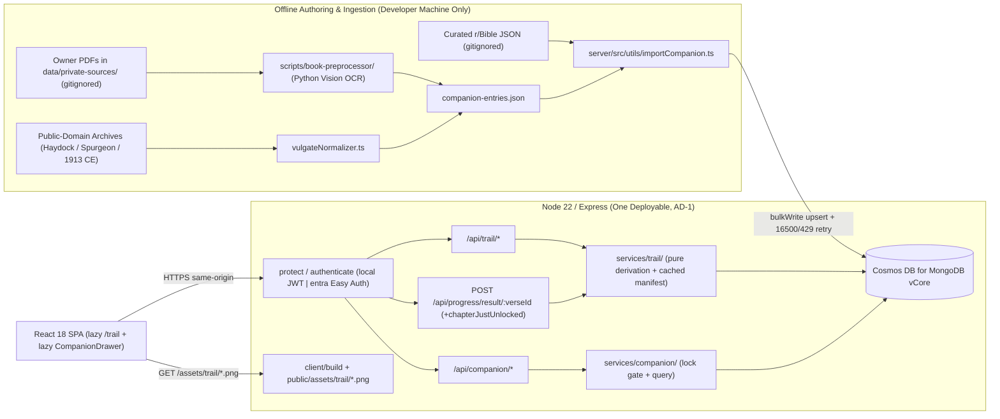

# Architecture Spine — Typing the Bible v3

> **Design Stance:** Boring, portable, single-process technology. v3 extends the v1/v2 layered monolith (`routes -> controllers -> services -> models`, AD-1 through AD-9) with **one new MongoDB collection** (`CompanionEntry`), **two pure server services** (`services/trail/` and `services/companion/`), **two `protect`-gated route groups** (`/api/trail/*` and `/api/companion/*`), **one offline ingestion CLI** (`server/src/utils/importCompanion.ts`), and **two lazy-loaded client feature folders** (`components/trail/` and `components/companion/`). No external scraping services, no distributed queues, no redundant unlock tables, and zero changes to `Result`, `Progress`, `Verse`, or `client/public/index.html`.

---

## 0. System Topology & Dependency Direction



**Dependency invariants (extending v1):**
- `routes -> controllers -> services -> models`; `config.ts` and `utils/` are leaf modules.
- `services/trail/` and `services/companion/` export **pure functions** over plain records so Jest unit tests exercise unlock derivation, biome rollups, and Vulgate normalization without DB setup.
- **Offline vs. Runtime hard wall:** Express **never** parses PDFs, calls Reddit/Firecrawl, or reads `data/private-sources/`. All ingestion runs exclusively through offline CLI scripts.

---

## 1. Data Layer: `CompanionEntry` Schema, Indexes & Chapter-Unlock Derivation

### 1.1 Canonical Alignment Decisions (Resolving Discovery Discrepancies)

Three prior artifacts used slightly different field names; v3 locks the canonical wire/storage names below so the already-extracted Anna Riva bundle (`data/private-sources/extracted/power-of-the-psalms/companion-entries.json`) imports with **zero manual edits and zero re-OCR**:

| Field | Locked Canonical Value | Why |
| :--- | :--- | :--- |
| `workId` | `'web-bible'` (default; extensible to future work slugs e.g. `'du-bois-souls-1903'`) | Matches `anna_riva_psalms.py` output verbatim and v3 product lock. |
| `chapter` | `number \| null` (`1..150` for chapter entries; `null` for book-level entries) | Matches `anna_riva_psalms.py` (`chapter: None`); `entryType` distinguishes multiple book-level docs cleanly. |
| `lens` | `'hoodoo-folk' \| 'historical-classic' \| 'community' \| 'personal-note'` | Unified kebab-case across DB, API, and UI (`importCompanion.ts` normalizes legacy aliases like `'community-notes'` / `'community_reddit'` -> `'community'`). |
| `entryType` | `'chapter-companion' \| 'book-introduction' \| 'bonus-meditations' \| 'daily-schedule'` | Directly matches `anna_riva_psalms.py` (`book-introduction`, `bonus-meditations`, `chapter-companion`) plus standalone schedule support. |
| `visibility` | `'public-domain' \| 'private-owner'` | Hard classification boundary preventing private PDF / Reddit cards from leaking into Git or public seeds. |
| `book` | Canonical English name from `USFM_TO_CANONICAL_BOOK` (`server/src/utils/bookMapping.ts`) | 1:1 match with `Verse.book` across all 73 Catholic WEB books. |
| `sectionKey` | 3-char USFM code for `web-bible` (`'GEN'`, `'PSA'`, `'TOB'`) derived automatically on ingest; explicit slug (`'ch-01'`) for future non-Bible works | Supports biome mapping and future non-Bible corpora without schema migration. |

### 1.2 `CompanionEntry` Mongoose Schema (`server/src/models/CompanionEntry.ts`)

```ts
export type CompanionLens =
  | 'hoodoo-folk'
  | 'historical-classic'
  | 'community'
  | 'personal-note';

export type CompanionEntryType =
  | 'chapter-companion'
  | 'book-introduction'
  | 'bonus-meditations'
  | 'daily-schedule';

export type CompanionVisibility = 'public-domain' | 'private-owner';
export type CompanionStatus = 'published' | 'draft' | 'archived';

export interface ICompanionPurpose {
  title: string;                 // e.g. "FOR PROTECTION AGAINST ENEMIES"
  body: string;                  // Commentary / working prose (plain text / lightweight markdown)
  page?: number;                 // Source page number
  citedVerses: string[];         // e.g. ["1-3", "7"]
  ritualTags: string[];          // e.g. ["White Candle", "Olive Oil", "Morning Practice"]
  octave?: string;               // Psalm 119 Hebrew octave: "ALEPH".."TAU"
  verseRange?: string;           // Psalm 119 octave verse span: "1-8".."169-176"
}

export interface ICompanionIndexPurpose {
  purpose: string;               // Back-of-book index label
  source: string;                // "powers-index" | "subject-list" | "powers-index-crossresolved"
  verseRange?: string | null;    // Optional octave/verse range e.g. "65-72"
}

export interface ICompanionDailyScheduleSlot {
  slot: string;                  // e.g. "Sunday morning", "Wednesday evening"
  psalm: number;                 // 1..150 (back-compatible with anna_riva_psalms.py)
  book?: string;                 // Optional generalized target book (defaults to "Psalms")
  chapter?: number;              // Optional generalized target chapter (defaults to psalm)
}

export interface ICompanionSource {
  sourceId: string;              // Stable slug: "anna-riva-psalms", "haydock-1859", "reddit-rbible-abc123"
  title: string;                 // "Power of the Psalms"
  author?: string;               // "Anna Riva"
  year?: number;                 // 1982
  publisher?: string;            // "Brawtley Press"
  isbn?: string;                 // "9781943138609"
  edition?: string;              // "1859 Dunigan Ed."
  pages?: number[];              // Source pages referenced
  numberingSystem?: 'masoretic-web' | 'vulgate-dr' | 'native';
  originalRef?: string;          // e.g. "Douay-Rheims Psalm 22" when normalized to WEB Psalm 23
  license?: 'public-domain' | 'private-owner-pdf' | 'fair-use-excerpt' | 'owner-authored';
  subreddit?: string;            // e.g. "r/Bible"
  authorHandle?: string;         // e.g. "u/..."
  retrievedAt?: Date;
}

export interface ICompanionEntry {
  upsertKey: string;             // Deterministic unique key (see §3.2)
  workId: string;                // Default "web-bible"
  sectionKey: string;            // USFM code ("GEN", "PSA") or non-Bible section slug
  book: string;                  // Canonical book name matching Verse.book
  chapter: number | null;        // 1..150 for chapter-companion; null for book-level entries
  entryType: CompanionEntryType;
  lens: CompanionLens;
  visibility: CompanionVisibility;
  status: CompanionStatus;       // Default "published"
  sortOrder: number;             // Default 0; deterministic order within lens tab
  title: string;
  summary: string;
  body: string;
  quoteExcerpt?: string;         // Optional fair-use quote (<= 300 chars for community cards)
  purposes: ICompanionPurpose[];
  indexPurposes: ICompanionIndexPurpose[];
  ritualTags: string[];          // Deduplicated chapter-level tags for fast filtering
  citedVerses: string[];         // Deduplicated chapter-level verse citations
  dailySchedule: ICompanionDailyScheduleSlot[]; // Populated on book-introduction / daily-schedule
  source: ICompanionSource;
  externalUrl?: string;          // Validated https:// reference or Reddit permalink
  contentHash: string;           // SHA-256 of canonical content fields for idempotency auditing
  createdAt?: Date;
  updatedAt?: Date;
}
```

**Schema validation & size bounds:**
- All nested subdocument arrays (`purposes`, `indexPurposes`, `dailySchedule`, `source`) set `{ _id: false }` to minimize BSON bloat and Cosmos storage footprint.
- `chapter`: `min: 1` when non-null; schema pre-validate enforces `entryType === 'chapter-companion' ? chapter !== null : chapter === null`.
- `externalUrl`: regex validator `/^https:\/\/\S+$/i` when provided (rejects `http://`, `javascript:`, `data:`).
- `quoteExcerpt`: max length `400` (`300` enforced in CLI validator for `lens === 'community'`).
- **Psalm 119 sizing check:** Psalm 119 has 22 Hebrew octaves (`ALEPH` 1–8 through `TAU` 169–176) stored inside `purposes[]` with `octave` and `verseRange` fields, plus ~30–50 `indexPurposes[]`. Total document size is ~25–45 KB — well below MongoDB's 16 MB limit and Cosmos vCore's optimal single-document read envelope.

### 1.3 Cosmos DB vCore Indexes (`CompanionEntry`)

Declared in `server/src/models/CompanionEntry.ts` and registered in `server/src/utils/initDb.ts` (`npm run db:init`, honoring AD-4 — never built lazily in request handlers):

```ts
// 1. Idempotent CLI upsert key (prevents duplicates across re-runs, handles chapter: null cleanly)
companionEntrySchema.index({ upsertKey: 1 }, { unique: true });

// 2. Primary Reading Room drawer lookup (book + chapter + published + grouped by lens)
companionEntrySchema.index({ workId: 1, book: 1, chapter: 1, status: 1, lens: 1, sortOrder: 1 });

// 3. Book overview & Trail companion-presence aggregation (entryType + book)
companionEntrySchema.index({ workId: 1, book: 1, entryType: 1, status: 1 });

// 4. Filtered tag/lens search inside Reading Room (multikey on ritualTags)
companionEntrySchema.index({ workId: 1, status: 1, lens: 1, ritualTags: 1 });
```

**Why `upsertKey` is a single string field instead of a 7-field compound unique index:**
- Cosmos DB for MongoDB vCore and MongoDB handle `null` values in compound unique indexes with subtle partial-filter caveats across driver versions, and long compound unique keys amplify index memory. A single deterministic string `upsertKey = "${workId}:${book}:${chapter ?? 'book'}:${entryType}:${lens}:${source.sourceId}:${sortOrder}"` guarantees portable, predictable idempotency across `mongodb-memory-server`, local MongoDB, and Cosmos DB vCore.

### 1.4 Chapter-Unlock Derivation Directly from `Progress` (Trade-Off Analysis)

**Decision (AD-11): Derive chapter unlock state on read from `Progress` + cached `Verse` chapter manifest. Do NOT introduce a separate `ChapterUnlock` collection.**

#### Verified Ground-Truth Property of the WEB Catholic Canon
Static verification against `data/WEB_Catholic_Version_for_game_updated.csv` confirms:
- **73 canonical books, 0 gaps** in `verseOrder` (`Genesis`: `1..1533`, `Psalms`: `13774..16234`).
- **1,328 canonical chapters, 0 gaps** in `verseOrder` (every chapter occupies a strictly contiguous integer interval `[minVerseOrder, maxVerseOrder]` with `maxVerseOrder - minVerseOrder + 1 === totalVerses`).
- `Progress` **already** stores `verseOrder: number` and maintains a compound unique index `{ user: 1, verseOrder: 1 }`.

#### How Derivation Works (Zero Schema Changes to `Verse`, `Progress`, or `Result`)
1. **In-Process Chapter Manifest (`server/src/services/trail/chapterManifest.ts`):**
   - Computed lazily on first request (and clearable via `resetChapterManifestCache()` for Jest suites) using ONE portable aggregation on `Verse`:
     ```ts
     Verse.aggregate([
       {
         $group: {
           _id: { book: '$book', chapter: '$chapter' },
           totalVerses: { $sum: 1 },
           minVerseOrder: { $min: '$verseOrder' },
           maxVerseOrder: { $max: '$verseOrder' },
         },
       },
     ])
     ```
   - Produces ~1,328 tiny records (~100 KB RAM): per-book `[minVerseOrder, maxVerseOrder]` plus per-chapter `[minVerseOrder, maxVerseOrder, totalVerses]` and an `orderToChapter` lookup. Because it derives dynamically from `Verse`, `mongodb-memory-server` tests that seed only 5–20 verses work identically to production!
2. **Book Trail Read (`GET /api/trail/books/:book`):**
   - Hits the **existing `{ user: 1, verseOrder: 1 }` index** with ONE range scan:
     ```ts
     Progress.find({
       user: req.user._id,
       completed: true,
       verseOrder: { $gte: bookMeta.minVerseOrder, $lte: bookMeta.maxVerseOrder },
     })
       .select('verseOrder bestWPM bestAccuracy lastAttemptDate')
       .lean();
     ```
   - For Genesis (max 1,533 rows) or Psalms (max 2,461 rows), a pure function folds progress into all chapters in `< 2 ms` in Node memory. Zero `$lookup`, zero 2,500-element `$in` arrays, zero multi-collection joins.
3. **Chapter Unlock Definition & State Machine:**
   - `dormant`: `completedVerses === 0`
   - `in_progress`: `0 < completedVerses < totalVerses`
   - `bloomed` (`unlocked: true`): `totalVerses > 0 && completedVerses >= totalVerses`
   - `unlockedAt`: `max(lastAttemptDate)` across the chapter's completed `Progress` rows when `bloomed`, else `null`.
4. **Live `chapterJustUnlocked` Detection on `POST /api/progress/result/:verseId`:**
   - `submitResult()` already loads `verse` and `existingProgress = await Progress.findOne({ user, verse: verseId })`.
   - **Re-type fast path:** If `existingProgress?.completed === true`, the verse was already completed before this submission, so the chapter could NOT have just transitioned from incomplete to complete -> return `chapterJustUnlocked: null` with **0 extra DB queries**.
   - **First-completion path (`!existingProgress || !existingProgress.completed`):** After saving `Progress`, execute 1 indexed `Progress.countDocuments({ user, completed: true, verseOrder: { $gte: ch.minVerseOrder, $lte: ch.maxVerseOrder } })`. Only if `completedCount >= ch.totalVerses` does the controller query `CompanionEntry.distinct('lens', { workId: 'web-bible', book: verse.book, chapter: verse.chapter, entryType: 'chapter-companion', status: 'published' })` and populate `chapterJustUnlocked`.

#### Trade-Off Matrix: Derived-on-Read vs. Materialized `ChapterUnlock` Collection

| Criterion | Option A: Derive from `Progress` (Chosen) | Option B: Materialized `ChapterUnlock` Table (Rejected) |
| :--- | :--- | :--- |
| **Consistency on result edit/delete** | **Guaranteed.** `recomputeVerseProgress()` / `deleteVerseProgress()` updates `Progress`, so chapter lock state auto-corrects immediately. | **Drift-prone.** Deleting a verse result requires extra cascade recomputation; Cosmos portability subset (AD-4) forbids multi-doc ACID transactions. |
| **Existing user backfill** | **Zero migration.** Every chapter Michael already finished in v1/v2 blooms automatically on day 1. | Requires a one-time backfill script and ongoing reconciliation checks. |
| **Write-path cost (`submitResult`)** | **0 extra queries** on re-types; **1 indexed count** on first-time verse completion. | Extra write/upsert on every final-verse submission + delete path hooks. |
| **Read-path cost on Cosmos Free tier** | **1 indexed range scan** on `{ user: 1, verseOrder: 1 }` per book view (max 2,461 tiny docs for Psalms); 1 scan on overview. | Slightly smaller read for overview, negligible at single-owner scale (<= 35,379 rows total). |
| **Timestamp semantics (`unlockedAt`)** | Reflects latest completion timestamp (`max(lastAttemptDate)`). Re-typing a verse in a bloomed chapter refreshes the date. | Preserves immutable "first-ever unlocked" timestamp. |

**Revisit trigger:** Introduce a materialized `UnitUnlock` collection *only if* (a) Typing the Bible becomes multi-tenant with social/leaderboard unlock feeds, or (b) a future non-Bible `workId` is added whose progress model does not use contiguous `verseOrder` ranges.

---

## 2. API Contract (`/api/companion/*`, `/api/trail/*`, & `submitResult`)

### 2.1 Universal Security, Auth & Cosmos RU Rules
- **Auth Gate (AD-2):** Both `companionRoutes.ts` and `trailRoutes.ts` apply `router.use(protect)` before every handler.
  - `local` mode: requires valid `Authorization: Bearer <jwt>` -> `401` if missing/invalid.
  - `entra` mode: requires `X-MS-CLIENT-PRINCIPAL-ID === OWNER_OID` -> `401` if header absent, `403` if wrong OID; `Authorization` header ignored.
  - **Zero unauthenticated leakage:** No `CompanionEntry` (public-domain OR `private-owner`) is ever queried or serialized for unauthenticated requests.
- **Server-Side Chapter Lock Enforcement:** On `GET /api/companion/:book/:chapter`, if the authenticated user has not completed all verses in `(book, chapter)`, the server **must not** return `body`, `purposes`, `indexPurposes`, `quoteExcerpt`, or `source.pages`. It returns `unlocked: false` with counts/lens teaser metadata only.
- **Envelope (AD-7):** Success `{ success: true, data }`; failure `{ success: false, message }` via `ApiError` and `errorHandler`. Never log `CompanionEntry` bodies in `morgan` or error logs.
- **Work Allowlist:** `workId` defaults to `'web-bible'` and validates against `server/src/utils/companionWorks.ts` (`400` if unknown).
- **Cosmos Free-Tier Bounds:** Every list/search endpoint enforces hard limits (`limit <= 50`), `.lean()`, explicit field `.select(...)`, and indexed predicates only (no `$where`, no `$lookup`, no unbounded regex scans on `body`).
- **Route Ordering:** Static sub-paths (`/search` and `/:book/guide`) **must** be mounted before parameterized `/:book/:chapter` in Express.

### 2.2 Trail Endpoints (`server/src/routes/trailRoutes.ts`)

| Method & Route | Query Params | Response `data` Shape | Notes & Error Codes |
| :--- | :--- | :--- | :--- |
| `GET /api/trail/overview` | `workId` (opt, default `web-bible`) | `{ workId, totalBooks: 73, totalChapters: 1328, bloomedChapters, inProgressChapters, activeTraveler: { biomeId, book, chapter } \| null, biomes: [{ biomeId, order, name, phase, books: [{ book, sectionKey, landmarkName, phase1Active, totalChapters, bloomedChapters, inProgressChapters, totalVerses, completedVerses, state, companionChapterCount }] }] }` | 1 indexed `Progress` scan + 1 compact `CompanionEntry` aggregation; cached `Verse` manifest. `400` invalid `workId`. `phase1Active: true` for `Genesis` & `Psalms`. |
| `GET /api/trail/books/:book` | `workId` (opt, default `web-bible`) | `{ workId, book, sectionKey, biomeId, landmarkName, phase1Active, state, bookMastered, totalChapters, bloomedChapters, totalVerses, completedVerses, activeChapter, legs: [{ legId, label, startChapter, endChapter, bloomedCount, totalCount }], chapters: [{ chapter, totalVerses, completedVerses, state, bestWPM, bestAccuracy, unlockedAt, hasCompanion, lensCounts }] }` | `400` unknown book; max 150 chapter objects (`Psalms`), ~18 KB gzipped. `lensCounts` is `{ 'hoodoo-folk': n, 'historical-classic': n, 'community': n }`. |

**Trail Leg Definitions (`server/src/services/trail/biomeCatalog.ts`):**
- **Genesis (`GEN`, 50 ch):** 5 legs of 10 chapters (`Ch. 1–10`, `Ch. 11–20`, `Ch. 21–30`, `Ch. 31–40`, `Ch. 41–50`).
- **Psalms (`PSA`, 150 ch):** 5 classical Books of the Psalter (`Book I: 1–41`, `Book II: 42–72`, `Book III: 73–89`, `Book IV: 90–106`, `Book V: 107–150`), which the UI subdivides into scenic clearings of 10–14 lantern posts.
- **All 73 Books / 9 Biomes:** Catalog encodes the exact 73-book canon order from `bookMapping.ts` with `phase1Active: true` for `Genesis` & `Psalms` and Phase 2/3 books rendered as mist-veiled horizons on `/trail` overview.

### 2.3 Companion Endpoints (`server/src/routes/companionRoutes.ts`)

| Method & Route | Query Params | Response `data` Shape | Notes & Error Codes |
| :--- | :--- | :--- | :--- |
| `GET /api/companion/search` | `workId`, `book`, `lens`, `tag`, `q`, `page` (def `1`), `limit` (def `20`, max `50`) | `{ items: CompanionSearchHitDTO[], page, limit, total, hasMore }` | Mounted **first** (before `/:book/*`). **Unlocked-only filter:** server computes user's bloomed `(book, chapter)` set first and restricts query so locked chapter text is **never** leaked via search! `q` capped at 80 chars, escaped regex matched against `title`, `summary`, `ritualTags`, `purposes.title`, and `indexPurposes.purpose` (never full `body` regex scan). |
| `GET /api/companion/:book/guide` | `workId` (opt) | `{ workId, book, bookProgress: { bloomedChapters, totalChapters, completedVerses, totalVerses, bookMastered }, introductions: CompanionEntryDTO[], dailySchedule: [{ slot, book, chapter, state, unlocked }], bonusMeditations: CompanionEntryDTO[], lensCounts: { 'hoodoo-folk': number, 'historical-classic': number, 'community': number }, lenses: { 'hoodoo-folk': CompanionEntryDTO[], 'historical-classic': CompanionEntryDTO[], 'community': CompanionEntryDTO[] } }` | Mounted **before** `/:book/:chapter`. Authenticated owner accesses book-level guides (`chapter: null`: `book-introduction`, `dailySchedule[]` with live chapter status, and `bonus-meditations`) without requiring full-book completion (PD-1). |
| `GET /api/companion/:book/:chapter` | `workId` (opt), `lens` (opt filter) | **Locked:** `{ workId, book, chapter, unlocked: false, progress: { completedVerses, totalVerses, state }, lensCounts, lenses: {} }`<br>**Unlocked:** `{ workId, book, chapter, unlocked: true, progress: { completedVerses, totalVerses, state, bestWPM, bestAccuracy, unlockedAt }, lensCounts, lenses: { 'hoodoo-folk': CompanionEntryDTO[], 'historical-classic': CompanionEntryDTO[], 'community': CompanionEntryDTO[] } }` | `400` unknown book/workId/lens or non-integer chapter; `404` chapter outside book's canonical range (e.g. Genesis 51, Psalms 151). Max 50 entries per chapter query. |

### 2.4 Additive Augmentations to Existing Endpoints

1. **`POST /api/progress/result/:verseId` (`server/src/controllers/progressController.ts`):** Keeps `result` and `progress` 100% unchanged and adds one optional field inside `data`:

```ts
chapterJustUnlocked: null | {
  workId: 'web-bible';
  book: string;
  chapter: number;
  totalVerses: number;
  unlockedAt: string;           // ISO-8601 UTC
  companionCount: number;       // Published chapter-companion docs across all lenses
  availableLenses: CompanionLens[];
}
```

Existing clients and v1/v2 tests ignore `chapterJustUnlocked` cleanly; `TypingTest.tsx` consumes it to enqueue the Chapter Bloom whisper pill without issuing any follow-up polling request.

2. **`GET /api/verses/next?book=<Book>&chapter=<N>` (`server/src/controllers/verseController.ts`):** Backward-compatible extension of the existing `protect`-gated `/api/verses/next` route to support direct chapter deep-links from `/trail` (`/typing?book=<Book>&chapter=<N>`):
   - When `chapter` is omitted: existing book/global behavior is unchanged.
   - When `chapter` is provided (validated positive integer within canonical book bounds, else `400`/`404`): returns the lowest untyped `verseOrder` in `(book, chapter)` (`{ chapterComplete: false, complete: false, verse }`), or verse 1 of that chapter with `{ chapterComplete: true, complete: false, verse }` when Michael clicks **Re-type Chapter** on an already-bloomed waypoint.

---

## 3. Ingestion CLI Pipeline (`server/src/utils/importCompanion.ts`)

### 3.1 Shared Cosmos Bulk-Write & Retry Engine (`server/src/utils/cosmosBulk.ts`)

Extract the proven throttling/retry machinery from `server/src/utils/importData.ts` into a shared leaf helper `server/src/utils/cosmosBulk.ts` (used by both `importData.ts` and `importCompanion.ts`) so retry behavior never diverges:
- **Retryable codes:** `16500` (Cosmos RequestRateTooLarge), `429`, `50`, `91`, `189`, `10107`, `11600`, `11602`, `13435`, `13436`, plus `RetryableWriteError` label and `RetryAfterMs` message parsing.
- **Partial-batch narrowing:** Uses `bulkWrite(ops, { ordered: false })`; on partial `writeErrors`, narrows `currentOps` strictly to failed indices and accumulates partial `matchedCount`/`modifiedCount`/`upsertedCount`.
- **Backoff:** Honors `RetryAfterMs` when present, otherwise exponential `min(maxDelayMs, baseDelayMs * 2^attempt) + jitter(0..50ms)` (`baseDelayMs = 150`, `maxDelayMs = 10000`, `maxRetries = 6`).
- **Batch size:** Defaults to **`batchSize = 50`** for `CompanionEntry` (vs. `500` for tiny `Verse` docs) because companion documents hold multi-paragraph prose and Psalm 119's 22 octaves (~5–45 KB/doc), keeping every batch safely under 2 MB and avoiding Cosmos Free-tier RU spikes.

### 3.2 CLI Contract, Validation & Idempotency (`server/src/utils/importCompanion.ts`)

Add npm script in `server/package.json`: `"import-companion": "ts-node src/utils/importCompanion.ts"`.

```bash
# Dry-run validation against canonical WEB 73-book / 1,328-chapter boundaries (no DB writes)
npm --prefix server run import-companion -- \
  --file ../data/private-sources/extracted/power-of-the-psalms/companion-entries.json \
  --dry-run

# Live idempotent upsert into MONGODB_URI (local MongoDB or Cosmos DB vCore)
npm --prefix server run import-companion -- \
  --file ../data/private-sources/extracted/power-of-the-psalms/companion-entries.json \
  --batch-size 50
```

**Deterministic normalization & validation steps executed before any DB write:**
1. **Bundle envelope check:** Accepts canonical `companion-entries.json` emitted by `scripts/book-preprocessor/` (`{ schemaVersion, profile, workId, visibility, source, entryCount, entries[] }`).
2. **Source ID & Upsert Key synthesis:**
   - `sourceId = entry.source?.sourceId ?? bundle.profile ?? slugify(entry.source.title)` (seamlessly handles `anna_riva_psalms.py`'s existing output!).
   - `sectionKey = workId === 'web-bible' ? canonicalBookToUsfm(entry.book) : entry.sectionKey`.
   - `upsertKey = "${workId}:${entry.book}:${entry.chapter ?? 'book'}:${entry.entryType}:${lens}:${sourceId}:${sortOrder}"`.
   - Rejects duplicate `upsertKey` values within the same bundle (fail-fast before writing).
3. **Canon integrity validation:** For `workId === 'web-bible'`, validates `book` against `CANONICAL_BOOK_ORDER` and validates `chapter` (when non-null) against `CANONICAL_CHAPTER_COUNTS[book]` (e.g., `Genesis: 50`, `Psalms: 150`, `Esther: 10`, `Daniel: 14`) so mis-numbered imports fail loudly rather than creating unreachable orphan cards.
4. **URL & Fair-Use guardrails:**
   - Rejects any `externalUrl` not starting with `https://`.
   - For `lens === 'community'`, requires `externalUrl` and `source.subreddit`, and rejects `quoteExcerpt.length > 300`.
5. **Copyright / Git-Safety Check:**
   - If any entry has `visibility === 'private-owner'` and the resolved `--file` path lies *inside* the git repository outside `data/private-sources/`, abort with a clear error unless `--allow-nonstandard-private-path` is passed — preventing accidental placement of copyrighted JSON in tracked folders.
6. **Status Filtering & Pruning:**
   - Imports entries with `status: 'published'` (default when omitted) and skips `'draft'` unless `--include-drafts` is passed.
   - Optional `--archive-missing-for-source <sourceId>` flag marks previously imported docs for that `sourceId` whose `upsertKey` is absent from the new bundle as `status: 'archived'` (cleanly handles removed Reddit threads or corrected parses without destructive drops).
7. **Idempotent `bulkWrite`:** Computes `contentHash = sha256(stableStringify(contentPayload))` and runs `updateOne({ upsertKey }, { $set: {...doc, updatedAt}, $setOnInsert: { upsertKey, createdAt } }, { upsert: true })`.

### 3.3 Vulgate / Douay-Rheims -> WEB Normalizer Spec (`server/src/utils/vulgateNormalizer.ts`)

Required for ingesting **Fr. George Leo Haydock's *Catholic Bible Commentary* (1859)** and any other Vulgate/Douay-Rheims public-domain source without breaking chapter unlocks:

1. **Pure Book-Alias Table (`normalizeDouayBookName(raw: string): string`):**
   - Maps legacy Douay-Rheims names to `USFM_TO_CANONICAL_BOOK`:
     - `1 Kings (DR)` -> `1 Samuel`, `2 Kings (DR)` -> `2 Samuel`, `3 Kings (DR)` -> `1 Kings`, `4 Kings (DR)` -> `2 Kings`
     - `1 Esdras` -> `Ezra`, `2 Esdras` -> `Nehemiah`, `1–2 Paralipomenon` -> `1–2 Chronicles`
     - `Canticle of Canticles` -> `Song of Solomon`, `Ecclesiasticus` -> `Sirach`, `Tobias` -> `Tobit`
     - `1–2 Machabees` -> `1–2 Maccabees`, `Apocalypse` -> `Revelation`
     - `Isaias`/`Jeremias`/`Ezechiel`/`Osee`/`Micheas`/`Habacuc`/`Sophonias`/`Aggeus`/`Zacharias`/`Malachias`/`Jonas` -> standard WEB names in `bookMapping.ts`
   - Validates Greek-canonical chapter bounds (`Esther` 1–10 matching `ESG`, `Daniel` 1–14 matching `DAG` including Susanna ch. 13 and Bel & the Dragon ch. 14).
2. **Exact Deterministic Psalm Alignment (`normalizeVulgatePsalm(drPsalm, verseBlocks?)`):**
   | Douay-Rheims / Vulgate | Transform | WEB / Masoretic Target | Stored `source.originalRef` |
   | :--- | :--- | :--- | :--- |
   | `DR 1..8` | 1:1 | `WEB 1..8` | `Douay-Rheims Psalm {n}` |
   | `DR 9` | **Split** | vv. 1–21 -> `WEB 9`; vv. 22–39 -> `WEB 10` | `Douay-Rheims Psalm 9 (vv. 1–21)` / `(vv. 22–39)` |
   | `DR 10..112` | **Shift +1** | `WEB (n + 1)` (`11..113`) | `Douay-Rheims Psalm {n}` |
   | `DR 113` | **Split** | vv. 1–8 -> `WEB 114`; vv. 9–26 -> `WEB 115` | `Douay-Rheims Psalm 113 (vv. 1–8)` / `(vv. 9–26)` |
   | `DR 114` + `DR 115` | **Merge** | `WEB 116` (concatenated with subheadings) | `Douay-Rheims Psalms 114–115` |
   | `DR 116..145` | **Shift +1** | `WEB (n + 1)` (`117..146`) | `Douay-Rheims Psalm {n}` |
   | `DR 146` + `DR 147` | **Merge** | `WEB 147` (concatenated with subheadings) | `Douay-Rheims Psalms 146–147` |
   | `DR 148..150` | 1:1 | `WEB 148..150` | `Douay-Rheims Psalm {n}` |
3. **Provenance & Test Requirement:** Every normalized entry sets `source.numberingSystem = 'vulgate-dr'` and `source.originalRef` so the Reading Room transparently displays e.g. *"Haydock 1859 (Douay-Rheims Ps. 22)"* inside WEB Psalm 23. Jest unit tests must assert all 150 WEB Psalm outputs from a 150-psalm DR fixture (explicitly testing boundaries `8, 9, 10, 113, 114, 115, 116, 146, 147, 148`).

### 3.4 Curated `r/Bible` Offline JSON Format Spec

Live Reddit scraping from Express is **prohibited** (Firecrawl blocks Reddit; Reddit OAuth requires pre-approval; user comments are copyrighted). Community cards are authored/reviewed offline in `data/private-sources/community/rbible-curated.json` (gitignored) using the **exact same `companion-entries.json` envelope** consumed by `importCompanion.ts`:

```json
{
  "schemaVersion": "1.0",
  "profile": "reddit-rbible-curated",
  "workId": "web-bible",
  "visibility": "private-owner",
  "source": {
    "sourceId": "reddit-rbible",
    "title": "r/Bible Curated Study Highlights",
    "subreddit": "r/Bible",
    "license": "fair-use-excerpt"
  },
  "entryCount": 1,
  "entries": [
    {
      "workId": "web-bible",
      "book": "Psalms",
      "chapter": 23,
      "entryType": "chapter-companion",
      "lens": "community",
      "visibility": "private-owner",
      "status": "published",
      "sortOrder": 0,
      "title": "Why 'valley of the shadow of death' also reads as 'deepest darkness'",
      "summary": "Readers compare ancient Near Eastern shepherd imagery and the Hebrew tsalmaveth translation nuances.",
      "body": "### Reader Question\n...\n\n### Key Perspectives\n- ...",
      "quoteExcerpt": "Short attributed excerpt <= 300 chars...",
      "ritualTags": ["Shepherd Imagery", "Translation Note"],
      "citedVerses": ["4"],
      "externalUrl": "https://www.reddit.com/r/Bible/comments/<threadId>/<slug>/",
      "source": {
        "sourceId": "reddit-rbible-<threadId>",
        "title": "Original thread title",
        "authorHandle": "u/<handle>",
        "subreddit": "r/Bible",
        "license": "fair-use-excerpt",
        "retrievedAt": "2026-11-20T00:00:00.000Z"
      }
    }
  ]
}
```

---

## 4. Frontend Architecture: Living Trail & Companion Reading Room

### 4.1 Hybrid Rendering Decision: Static Pixel Atlases + `<canvas>` Diorama + Semantic DOM Overlay

| Option | Verdict | Rationale |
| :--- | :--- | :--- |
| **Pure CSS/DOM tiles** | Rejected for scene backdrop | Hundreds of terrain tiles + props per clearing inflate DOM size and produce sub-pixel seams across browser zoom levels. |
| **Pure `<canvas>` (including hit-testing & text)** | Rejected | Breaks keyboard focus, screen readers, copyable text, and WCAG AA forced-colors; requires painful custom hit-testing. |
| **Static Pixel Atlases (`client/public/assets/trail/`) + DPR-Aware `<canvas>` Backdrop + Semantic DOM Waypoint Overlay + Table Fallback** | **Chosen (AD-14)** | Best of all worlds: zero JS bundle bloat, crisp integer pixel scaling, native keyboard/ARIA accessibility, trivial Jest/jsdom testability, and 100% CSP compliance. |

**Asset pipeline & Daylight/Twilight theme handling:**
- Store internally generated 16-bit PNG sprite sheets and crisp micro-icons in **`client/public/assets/trail/`** (served as `/assets/trail/*.png` in both dev and production `client/build/assets/trail/`):
  - `traveler-michael-daylight.png` & `traveler-michael-twilight.png` (`16x24` frames; Black male traveler in clean modern casual attire per UX spec)
  - `keepers-phase1-daylight.png` & `keepers-phase1-twilight.png` (`16x24` frames; Genesis Root-Keeper & Psalms Twilight Psalmist)
  - `terrain-tiles-phase1-daylight.png` & `terrain-tiles-phase1-twilight.png` (`16x16` tiles)
  - `landmarks-phase1-daylight.png` & `landmarks-phase1-twilight.png` (`32x32` props)
  - `lens-micro-icons.svg` (`16x16` crisp pixel SVGs for Hoodoo & Folk, Historical & Classic, Community)
- **Why pre-baked Daylight & Twilight PNG pairs instead of runtime `ImageData` LUT recoloring:** Pre-baked indexed 16-bit PNGs are ~4–12 KB each, incur **0 ms runtime CPU** on `ThemeToggle`, avoid `getImageData` offscreen canvas complexity, and allow standard `` badges inside popovers and the Atlas strip to share the exact same art files!
- **Deterministic pixel asset generator:** Keep the source palette + pixel-art generator script in `scripts/trail-assets/` (offline tooling, not runtime browser code) so assets remain 100% internally authored and reproducible.
- **Canvas rendering contract (`BiomeCanvas.tsx`):**
  - Integer logical scaling (`2x` / `3x` / `4x`) with `ctx.imageSmoothingEnabled = false` and CSS `image-rendering: pixelated`.
  - Guards `const ctx = canvas.getContext('2d'); if (!ctx) return;` cleanly so Jest/jsdom component tests never throw without native canvas bindings.
  - Pauses animation automatically when `document.visibilityState === 'hidden'` and caps frame cadence to `180ms/frame` (~5.5 FPS) when motion is enabled.

### 4.2 Helmet CSP Compatibility (`server/src/index.ts` & `client/public/index.html`)

Verified against `server/src/index.ts` lines 30–43:
- Helmet's active CSP uses `getDefaultDirectives()` (`default-src 'self'`, `img-src 'self' data:`) plus the two explicit SHA-256 hashes on `script-src` for the anti-FOUC inline theme script in `client/public/index.html`.
- **Zero CSP relaxation required and zero `index.html` edits allowed:**
  - `/assets/trail/*.png` and `/assets/trail/*.svg` are same-origin `'self'` assets.
  - `<canvas>` drawing of same-origin images uses zero `eval`, zero `blob:`, and zero inline scripts.
  - All Trail and Companion CSS lives in normal imported `.css` modules/files compiled by CRA.
  - **Safe Companion text renderer (`CompanionMarkdown.tsx`):** Never use `dangerouslySetInnerHTML` on `CompanionEntry.body` or `purposes[].body`. Parse the structured subset (`###` headings, paragraphs separated by `\n\n`, `- ` bullet lists) into plain React elements. Render `externalUrl` only after checking `/^https:\/\//i` with `target="_blank" rel="noopener noreferrer"`.

### 4.3 `prefers-reduced-motion` & WCAG 2.1 AA Accessibility

- **Reduced Motion (`useReducedMotion.ts` + CSS `@media (prefers-reduced-motion: reduce)`):**
  - When reduced motion is active, `<BiomeCanvas />` **never starts a `requestAnimationFrame` loop** — it paints one static frame (traveler on `idle` frame 0, steady lanterns, zero mist/firefly drift) and redraws only on data, leg, or theme changes.
  - Waypoint transitions snap immediately (or <= `150ms` opacity fade); `<CompanionDrawer />` opens/closes without slide transforms.
- **Keyboard & Screen Reader Support:**
  - `BiomeCanvas` carries `role="img"` + dynamic `aria-label` (e.g., `"Psalms Book I trail clearing, 12 of 41 chapters bloomed"`).
  - `WaypointOverlay.tsx` positions semantic `<button>` nodes directly over each canvas waypoint using percentage coordinates matching the canvas's logical viewBox, implementing roving `tabindex` (`ArrowLeft`/`ArrowRight`/`ArrowUp`/`ArrowDown` step across waypoints; `Enter`/`Space` opens the waypoint popover).
  - **One-Click Accessible Fallback (`TrailChapterList.tsx`):** Mounted right in the Trail toolbar (matching `BookCoverage.tsx` / NFR-2), toggling a filterable semantic `<table>` of chapters with status text + non-color glyph (`Dormant`, `In Progress 14/26`, `Bloomed ✦`), best WPM/Accuracy, and direct `Type Chapter` / `Open Companion` actions.
  - **Drawer Accessibility (`CompanionDrawer.tsx`):** `role="dialog" aria-modal="true" aria-labelledby`, focus trap while open, ARIA `tablist`/`tab`/`tabpanel` with Left/Right arrow navigation, focus restoration on close, and strict **`Escape` precedence** (closes Drawer first without exiting `TypingTest.tsx`'s `zenMode`).
  - **Polite Announcements:** `ChapterBloomToast.tsx` uses a single `aria-live="polite" aria-atomic="true"` slot (never `assertive`).

### 4.4 Protecting Typing Keystroke Latency (`TypingTest.tsx`)

1. **Zero Canvas on `/typing`:** `BiomeCanvas` and pixel-atlas images are mounted **exclusively** inside lazy-loaded `/trail` (`React.lazy(() => import('./components/trail/LivingTrailPage'))`).
2. **Lazy Companion Drawer:** `<CompanionDrawer />` is code-split via `React.lazy` and only fetched/mounted when the user opens it (never bundled into `/typing`'s critical path).
3. **Pure Keystroke Hot Path:** `handleInputChange` in `TypingTest.tsx` does **not** read or mutate any trail/companion state.
4. **Async Off-Path Unlock Notification:** `TypingTest.tsx` already clears `typedText` and advances to the next verse *before* `ProgressService.submitResult(...)` resolves (lines 612–637). When `submitResult` resolves with `chapterJustUnlocked !== null`, it appends to a memoized `sessionUnlocks` array rendered by `<ChapterBloomToast />` (outside the typing textarea tree so `.typing-input-inline` never blurs or re-mounts).
5. **Single HTTP Boundary (AD-9):** Add `TrailService` and `CompanionService` to `client/src/services/api.ts` (following `StatsService` / `MemoryService` patterns). **Mock fallback rule:** When `REACT_APP_USE_MOCK_DATA=true`, `CompanionService` may return **synthetic public-domain placeholder text only** — never copyrighted owner text.

### 4.5 Structural Seed (Additive Files Only)

```text
ttb/
  client/
    public/assets/trail/               # Pre-baked Daylight/Twilight 16-bit PNG atlases + lens SVGs
    src/
      services/api.ts                  # + TrailService, + CompanionService, + chapterJustUnlocked type
      components/
        trail/
          LivingTrailPage.tsx          # Lazy-loaded /trail route (Atlas Strip + Clearing + List toggle)
          BiomeCanvas.tsx              # DPR-aware integer-scaled <canvas> renderer
          WaypointOverlay.tsx          # Keyboard-accessible semantic <button> overlay + popover
          TrailChapterList.tsx         # WCAG AA NFR-2 accessible table fallback
          trailLayouts.ts              # Logical coordinates & clearing segmentation (Genesis 5 legs / Psalms 5 Books)
        companion/
          CompanionDrawer.tsx          # Lazy-loaded slide-over dialog (Esc precedence, focus trap, 3 tabs)
          CompanionLensPanel.tsx       # Renders purposes[], Psalm 119 octaves, indexPurposes[], ritualTags[], sources
          CompanionMarkdown.tsx        # Safe plain-React prose renderer (zero dangerouslySetInnerHTML)
          ChapterBloomToast.tsx        # Quiet whisper pill & Zen topbar chip + session unlock queue
  server/src/
    models/CompanionEntry.ts           # New Mongoose model + 4 Cosmos-safe indexes
    services/
      trail/
        chapterManifest.ts             # Cached Verse chapter range manifest (1,328 chapters)
        biomeCatalog.ts                # 9 biomes / 73-book metadata + Genesis/Psalms trail legs
        trailService.ts                # Pure functions: buildTrailOverview, buildBookTrail, getChapterUnlockStatus
      companion/
        companionService.ts            # Chapter lock gate, lens grouping, safe unlocked-only search
    controllers/
      trailController.ts
      companionController.ts
    routes/
      trailRoutes.ts                   # router.use(protect)
      companionRoutes.ts               # router.use(protect)
    utils/
      cosmosBulk.ts                    # Shared 16500/429 retry + partial-batch narrowing (from importData.ts)
      companionWorks.ts                # workId registry ('web-bible' + future non-Bible extensibility)
      vulgateNormalizer.ts             # Deterministic Douay-Rheims/Haydock -> WEB book & Psalm normalizer
      importCompanion.ts               # Idempotent offline bundle CLI (--file, --dry-run, --batch-size)
  scripts/
    trail-assets/                      # Offline deterministic 16-bit pixel-atlas generator
```

---

## 5. Architectural Decision Records (ADRs) for Build Enforcement

These extend v1's `AD-1` through `AD-9` (all of which remain binding). Reddy must enforce `AD-10` through `AD-16` across all v3 stories and PRs.

### AD-10 — Single Extensible `CompanionEntry` Collection (`workId`-Scoped, Reconciled with Pre-Processor)
- **Decision:** Model all companion lenses (`hoodoo-folk`, `historical-classic`, `community`, `personal-note`) and entry granularities (`chapter-companion`, `book-introduction`, `bonus-meditations`, `daily-schedule`) in one `CompanionEntry` collection keyed by deterministic string `upsertKey`, using `workId: 'web-bible'` and `chapter: number | null`. Store Anna Riva's `purposes[]` (including Psalm 119 `octave` + `verseRange`), `indexPurposes[]`, `ritualTags[]`, `citedVerses[]`, and `dailySchedule[]` as typed subdocuments without `_id`.
- **Trade-off:** Slightly wider document schema than splitting separate collections per lens, traded for one query per drawer open, one ingestion pipeline, and zero schema migration when adding non-Bible `workId` works.
- **Prevents:** Duplicate schemas diverging between Python pre-processor output and Mongoose; brittle compound unique indexes on nullable `chapter`.

### AD-11 — Derived Chapter Unlocks from `Progress` (No `ChapterUnlock` Collection)
- **Decision:** Compute chapter unlock state (`dormant | in_progress | bloomed`) on read from `Progress` using a cached `Verse` chapter manifest (`minVerseOrder..maxVerseOrder`) and the existing `{ user: 1, verseOrder: 1 }` index. Augment `POST /api/progress/result/:verseId` with an additive `chapterJustUnlocked` payload that short-circuits (0 extra reads) when a verse was already completed.
- **Trade-off:** `unlockedAt` reflects `max(lastAttemptDate)` rather than an immutable first-unlock date, traded for zero dual-write drift on `recomputeVerseProgress()` / result deletion, zero backfill migration, and full AD-4 Cosmos portability without transactions.
- **Prevents:** Stale unlock badges after deleted attempts; multi-document write inconsistencies on Cosmos DB vCore.

### AD-12 — Hard Auth, Lock-Gate & Copyright Vault Boundary
- **Decision:** Gate all `/api/companion/*` and `/api/trail/*` routes behind `protect` (AD-2). Enforce chapter-completion gating server-side (locked chapters return teaser counts/lenses only—never `body`, `purposes`, or `quoteExcerpt`). Keep all `visibility: 'private-owner'` source files exclusively inside gitignored `data/private-sources/` and reject accidental imports from tracked repo directories.
- **Trade-off:** Owner cannot inspect locked chapter commentary via the API before completing the chapter (by design, preserving the unlock reward loop); private books require running the local CLI per environment.
- **Prevents:** Copyrighted Anna Riva / Hurston / Reddit text leaking into Git, client mock files, unauthenticated responses, or server logs.

### AD-13 — Offline CLI-First Ingestion with Shared Cosmos 16500/429 Backoff & Deterministic Normalizers
- **Decision:** All companion data enters MongoDB/Cosmos exclusively via `server/src/utils/importCompanion.ts` consuming canonical `companion-entries.json` bundles in 50-doc unordered `bulkWrite` batches through shared `cosmosBulk.ts` retry logic. Haydock/Douay-Rheims ingestion runs through pure, unit-tested `vulgateNormalizer.ts` (Psalms 9–147 shifts/splits/merges + book aliases). `r/Bible` entries are offline human-curated JSON only (`quoteExcerpt <= 300 chars`, validated Reddit permalink).
- **Trade-off:** No in-app PDF upload or live Reddit feed in v3, traded for zero runtime OCR dependencies on App Service B1, zero scraping TOS violations, and repeatable dry-run-verified imports.
- **Prevents:** Cosmos 16500 throttling failures during seeding; off-by-one Vulgate Psalm mismatches; Express server bloat or Reddit anti-bot failures.

### AD-14 — Hybrid Trail Renderer: Pre-Baked Static Pixel Atlases + `<canvas>` + Semantic DOM/Table Layers
- **Decision:** Serve pre-baked Daylight and Twilight 16-bit PNG sprite sheets from `client/public/assets/trail/`, render scenic biome clearings on an integer-scaled DPR-aware `<canvas>` (`imageSmoothingEnabled = false`), overlay keyboard-focusable `<button>` waypoints (`WaypointOverlay.tsx`), and provide a one-click semantic `<table>` fallback (`TrailChapterList.tsx`). Freeze canvas to static frame 0 with zero `requestAnimationFrame` loop under `prefers-reduced-motion: reduce`.
- **Trade-off:** Two tiny PNG palette variants per asset instead of runtime pixel-shader recoloring, traded for zero runtime CPU on theme toggles, clean Helmet CSP compatibility (`img-src 'self'`), zero `index.html` changes, and seamless WCAG AA + jsdom testing.
- **Prevents:** Blurry pixel art, inaccessible canvas-only maps, CSP breakage on production deploy, and jsdom test crashes.

### AD-15 — Typing Studio Flow & Keystroke Latency Isolation
- **Decision:** Lazy-load `/trail` and `<CompanionDrawer />` via `React.lazy`. Never mount `<canvas>` or animation loops on `/typing`. Keep `TypingTest.tsx` keystroke handlers free of trail/companion state, process `chapterJustUnlocked` asynchronously after `autoAdvance` clears input, never auto-open the drawer or steal focus when `autoAdvance` or `zenMode` is active, and give `<CompanionDrawer />` strict `Escape`-key precedence ahead of `zenMode`.
- **Trade-off:** Tiny loading state on first Drawer open (masked by prefetching or fast local chunk), traded for guaranteed 0 ms keystroke regression on the core typing loop.
- **Prevents:** Input lag during fast typing, accidental Zen Mode exits, and intrusive popups breaking Auto-Advance rhythm.

### AD-16 — Safe Plain-React Companion Rendering & Strict External URL Validation
- **Decision:** Render all companion prose (`body`, `purposes[].body`) via a lightweight structural Markdown-to-React component (`CompanionMarkdown.tsx`) with zero `dangerouslySetInnerHTML`. Allowlist `externalUrl` strictly to `https://` both at schema/CLI ingest and UI render (`target="_blank" rel="noopener noreferrer"`).
- **Trade-off:** Limits companion formatting to headings, paragraphs, emphasis, and lists (no arbitrary HTML embeds), traded for complete XSS immunity against OCR artifacts or external commentary text under strict CSP.
- **Prevents:** Stored XSS via imported commentary/OCR strings or unsafe `javascript:` link injection.

---

## 6. Verification Checklist for Reddy (Before Any Story Ships)

- **Schema & Indexes:** `CompanionEntry` registered in `server/src/models/index.ts` and `server/src/utils/initDb.ts`; `npm run db:init` succeeds on `mongodb-memory-server` and Cosmos vCore.
- **Idempotency & Normalizer Tests:** Running `importCompanion` twice on the same fixture yields `upsertedCount: 0` on run 2; mocked Cosmos `16500` / `429` partial `writeErrors` retry and converge; `vulgateNormalizer` passes all 150 Psalm boundary assertions (`8, 9, 10, 113, 114, 115, 116, 146, 147, 148`).
- **Auth & Lock-Gate Tests:** Supertest suites verify `401` unauthenticated, `403` wrong Entra OID, locked-chapter teaser-only response (asserting `body` & `purposes` absent), unlocked-chapter full multi-lens response, and search never leaking locked chapter bodies.
- **Client & Accessibility Tests:** Mocking only `services/api.ts` (AD-6), verify `TypingTest` focus preservation + `Escape` precedence in Zen/Auto-Advance, `CompanionDrawer` ARIA tabs & safe rendering (script-tag string rendered as literal text), `LivingTrailPage` keyboard waypoint navigation + `TrailChapterList` table toggle + `prefers-reduced-motion` static render.
- **Repo Hygiene & CI Gate:** `git status` contains zero files under `data/private-sources/`; `client/public/index.html` is untouched; `CI=true npm run typecheck && CI=true npm run build && CI=true npm test` passes with 0 warnings.
