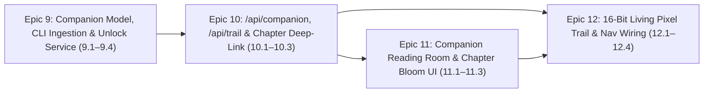

# Typing the Bible v3 (Phase 1) — Epics & Stories

## Overview

Breaks down [SPEC.md](file:///Users/mikewarren/ttb/_bmad-output/specs/spec-typing-the-bible-v3/SPEC.md) into **4 sequenced Epics (Epics 9–12)** and **14 build-ready stories** so Reddy can implement, test, and verify Phase 1 story-by-story. Continues the repository's epic numbering after v1 (Epics 1–4) and v2 (Epics 5–8).

**Phase 1 Scope:** Vertical slice delivering **Genesis (50 chapters)** and **Psalms (150 chapters across the 5 Classical Books of the Psalter)** across the **Multi-Lens Companion Reading Room** (*Hoodoo & Folk*, *Historical & Classic*, *Community `r/Bible`*) and the **Stardew-Inspired 16-Bit Living Pixel Trail** (`/trail`), using CLI-first ingestion and `workId: "web-bible"` extensibility for all 73 WEB Catholic books and future non-Bible works.

**Explicitly Out of Scope for Phase 1:** In-app PDF upload / browser OCR, live Reddit scraping or Firecrawl on Reddit, playable pixel trails for the other 71 books (rendered as mist-veiled Atlas horizons), multi-user features, and non-Bible typing UI.

---

## Dependency Graph & Build Sequence



- **Recommended Execution Order:** `9.1 → 9.2 → 9.3 → 9.4 → 10.1 → 10.2 → 10.3 → 11.1 → 11.2 → 11.3 → 12.1 → 12.2 → 12.3 → 12.4`
- **Parallelizable Pair (if running multiple builders):** Story `12.1` (internal pixel-art asset pipeline & LUT palette) can run in parallel with Epic 10/11 once `SPEC.md` and `v3-ux-companion-and-pixel-trail.md` are locked; Story `11.1–11.3` and `12.1–12.2` have disjoint client folders (`components/companion/` vs `components/trail/`).

### Capability Coverage Matrix

| Capability / NFR | Stories |
| :--- | :--- |
| **CAP-V3-1** (`CompanionEntry` & CLI ingestion) | 9.1, 9.2 |
| **CAP-V3-2** (Vulgate→WEB normalizer, PD & `r/Bible` curation) | 9.3 |
| **CAP-V3-3** (Derived chapter unlocks & protected APIs) | 9.4, 10.1, 10.2, 10.3 |
| **CAP-V3-4** (Chapter Bloom whisper pill & Companion Drawer) | 11.1, 11.2, 11.3 |
| **CAP-V3-5** (16-bit Living Trail, Genesis + Psalms, Black cast, modern avatar) | 12.1, 12.2, 12.3, 12.4 |
| **NFR-V3-1..5** (Latency, Cosmos portability, WCAG AA, CSP/Security, CI) | 9.2, 9.4, 10.1, 10.2, 11.2, 11.3, 12.1, 12.3, 12.4 |

---

## Epic 9: Companion Data Model, Unlock Derivation & CLI Ingestion

Establishes the MongoDB/Cosmos DB vCore schema, idempotent CLI ingestion pipeline (validating Anna Riva's already-extracted bundle plus Phase 1 public-domain and curated `r/Bible` bundles), Vulgate→WEB Psalm normalization, and zero-drift chapter unlock derivation from `Progress`.

### Story 9.1: `CompanionEntry` Model, Indexes & `workId` Work Registry

**Covers:** CAP-V3-1, NFR-V3-2  
**Depends on:** None  
**Primary files:** `server/src/models/CompanionEntry.ts`, `server/src/models/index.ts`, `server/src/utils/companionWorks.ts`, `server/src/tests/companionModel.test.ts`

As the owner, I want a canonical, `workId`-extensible `CompanionEntry` Mongoose model and work registry, so that Anna Riva's *Power of the Psalms*, 73-book public-domain commentaries, curated `r/Bible` cards, and future non-Bible works share one durable schema on Cosmos DB vCore.

**Acceptance Criteria:**

1. **Given** `server/src/models/CompanionEntry.ts` **When** inspected and compiled with `npm run typecheck` **Then** the schema supports:
   - Addressing: `workId` (string, default `"web-bible"`, required), `sectionKey` (string, e.g., USFM `"GEN"`, `"PSA"`, or non-Bible section slug), `book` (string, canonical name matching `Verse.book`), `chapter` (`number | null`, where `null` denotes book-level entries and `1..150` denotes chapter entries).
   - Classification & Safety: `entryType` (`"chapter-companion" | "book-introduction" | "bonus-meditations"`), `lens` (`"hoodoo-folk" | "historical-classic" | "community"`), `visibility` (`"public-domain" | "private-owner"`), `status` (`"draft" | "published" | "archived"`, default `"published"`), `sortOrder` (number, default `0`).
   - Content & Folk Metadata: `title`, `summary`, `body`, `purposes[]` (`{ title, body, page?, citedVerses?, ritualTags?, octave?, verseRange? }`), `indexPurposes[]` (`{ purpose, source?, verseRange? }`), `ritualTags[]`, `citedVerses[]`, `dailySchedule[]` (`{ slot, psalm }`), `quoteExcerpt?`, `externalUrl?`.
   - Provenance & Idempotency: `source` (`{ sourceId, title, author?, year?, publisher?, isbn?, edition?, pages?, numberingSystem?, originalRef?, subreddit?, authorHandle?, retrievedAt? }`), `contentHash` (SHA-256 string), timestamps.
2. **Given** the schema indexes **When** synced in `mongodb-memory-server` **Then** compound indexes exist for:
   - Primary chapter drawer lookup: `{ workId: 1, book: 1, chapter: 1, status: 1, lens: 1, sortOrder: 1 }`.
   - Book guide lookup: `{ workId: 1, book: 1, entryType: 1, status: 1 }`.
   - Idempotent upsert uniqueness key: `{ workId: 1, book: 1, chapter: 1, entryType: 1, lens: 1, 'source.sourceId': 1, sortOrder: 1 }` (`unique: true`).
3. **Given** `server/src/utils/companionWorks.ts` **When** queried for `"web-bible"` **Then** it returns metadata `{ workId: "web-bible", title: "World English Bible (Catholic)", totalSections: 73, totalUnits: 1328 }` and resolves canonical `book` ↔ USFM `sectionKey` via `server/src/utils/bookMapping.ts`, while permitting additional `workId` entries without schema migration.
4. **Given** unit tests in `server/src/tests/companionModel.test.ts` **When** inserting a chapter entry (including Psalm 119 octaves), a book-level `book-introduction` with `chapter: null` and `dailySchedule`, and a non-Bible `workId: "du-bois-souls-1903"` document **Then** all three validate and persist cleanly, and duplicate upsert keys are rejected.

---

### Story 9.2: Idempotent Companion Ingestion CLI (`importCompanion.ts`)

**Covers:** CAP-V3-1, NFR-V3-2, NFR-V3-4  
**Depends on:** Story 9.1  
**Primary files:** `server/src/utils/importCompanion.ts`, `server/package.json`, `server/src/tests/importCompanion.test.ts`

As the owner, I want a local CLI importer that loads canonical `companion-entries.json` bundles (starting with my extracted Anna Riva *Power of the Psalms* bundle) into MongoDB / Cosmos DB vCore idempotently, so that I can re-run imports safely without duplicates or throttling crashes and without ever committing copyrighted files to Git.

**Acceptance Criteria:**

1. **Given** a canonical `schemaVersion: "1.0"` JSON bundle (exact format emitted by `scripts/book-preprocessor/profiles/anna_riva_psalms.py`) **When** running `cd server && npm run import-companion -- --file <path>` **Then** it validates every entry, derives deterministic `source.sourceId` (from `bundle.profile` or `entry.source.sourceId`), `sectionKey` (from `bookMapping.ts` when `workId === "web-bible"`), and SHA-256 `contentHash`, and upserts in batches via `CompanionEntry.bulkWrite`.
2. **Given** a Cosmos DB throttling error (error code `16500` or HTTP `429`) during `bulkWrite` **When** retrying **Then** the importer backs off exponentially with bounded retries (mirroring `server/src/utils/importData.ts`) and logs batch progress cleanly.
3. **Given** the same bundle file is imported twice in a row against `mongodb-memory-server` **When** the second run completes **Then** `upsertedCount === 0`, total document count is unchanged, and existing documents retain consistent fields.
4. **Given** `--dry-run` is passed **When** running the CLI **Then** it validates the bundle and prints a summary (entry counts by `entryType`, `lens`, `visibility`, and `book`) without connecting to or mutating the database.
5. **Given** `--prune-source <sourceId>` is passed **When** running the CLI **Then** only entries matching that `source.sourceId` are removed (useful for revoking deleted community threads or rebuilding a source).
6. **Given** Michael's local gitignored bundle `data/private-sources/extracted/power-of-the-psalms/companion-entries.json` **When** tested with `--dry-run` locally **Then** it validates all **152 entries** (150 Psalms `chapter-companion` + 1 `book-introduction` with 14 `dailySchedule` slots + 1 `bonus-meditations`, 315 `purposes[]`, 22 Psalm 119 octaves, 304 `indexPurposes[]`) with 0 errors, and `git status` confirms nothing in `data/private-sources/` is tracked.

---

### Story 9.3: Vulgate→WEB Normalizer, Phase 1 PD Starter Bundles & Offline `r/Bible` Validator

**Covers:** CAP-V3-2, NFR-V3-4  
**Depends on:** Story 9.2  
**Primary files:** `server/src/utils/vulgateNormalizer.ts`, `server/src/utils/communityBundleValidator.ts`, `data/companion-seeds/phase1-pd-genesis-psalms.json`, `data/companion-seeds/community-template.example.json`, `server/src/tests/vulgateNormalizer.test.ts`

As the owner, I want deterministic Vulgate/Douay-Rheims → WEB normalization for Haydock commentary, a verified Phase 1 public-domain seed bundle for Genesis and Psalms, and an offline validator for curated `r/Bible` cards, so that all three Companion lenses have accurate, copyright-safe data from Day 1.

**Acceptance Criteria:**

1. **Given** `server/src/utils/vulgateNormalizer.ts` **When** unit tests execute across all Psalm boundaries and Douay-Rheims book aliases **Then**:
   - `normalizeVulgatePsalm(1..8)` → `WEB 1..8`;
   - `normalizeVulgatePsalm(9, verse)` → `WEB 9` for `v <= 21`, `WEB 10` for `v >= 22` (and chapter-level mapping flags split `WEB [9, 10]`);
   - `normalizeVulgatePsalm(10..112)` → `WEB (n + 1)` (`11..113`);
   - `normalizeVulgatePsalm(113, verse)` → `WEB 114` for `v <= 8`, `WEB 115` for `v >= 9`;
   - `normalizeVulgatePsalm(114)` & `normalizeVulgatePsalm(115)` → merge target `WEB 116`;
   - `normalizeVulgatePsalm(116..145)` → `WEB (n + 1)` (`117..146`);
   - `normalizeVulgatePsalm(146)` & `normalizeVulgatePsalm(147)` → merge target `WEB 147`;
   - `normalizeVulgatePsalm(148..150)` → `WEB 148..150`;
   - All legacy DR book names (`1–4 Kings`, `1–2 Esdras`, `Paralipomenon`, `Canticle of Canticles`, `Ecclesiasticus`, `Machabees`, `Apocalypse`, `Tobias`, `Osee`, `Micheas`, `Habacuc`, `Sophonias`, `Aggeus`, `Zacharias`) normalize 1:1 to canonical names in `server/src/utils/bookMapping.ts`.
2. **Given** `data/companion-seeds/phase1-pd-genesis-psalms.json` **When** validated and imported via `importCompanion.ts` **Then** every entry carries `visibility: "public-domain"` and `workId: "web-bible"`, providing:
   - *Historical & Classic* (`lens: "historical-classic"`): Book-level introductions for **Genesis** and **Psalms** (1913 *Catholic Encyclopedia* PD summaries) plus starter chapter commentaries for key Phase 1 Genesis & Psalms chapters (e.g., Genesis 1–3, 12, 22, 28, 37, 50; Psalms 1, 8, 22, 23, 27, 46, 51, 90, 91, 107, 119, 121, 139, 150) sourced from normalized Haydock (1859) and Spurgeon's *Treasury of David* / Matthew Henry (PD) with `source.originalRef` recorded where normalized.
   - *Hoodoo & Folk* (`lens: "hoodoo-folk"`): Public-domain folkloric starter entries for Genesis (drawing from pre-1931 PD sources: Puckett 1926 *Folk Beliefs of the Southern Negro* and Johnson 1925 *Book of American Negro Spirituals*) and select Psalms (Godfrey Selig pre-1923 *Secrets of the Psalms* PD baseline) so Genesis also has authentic *Hoodoo & Folk* depth alongside Anna Riva's private Psalms vault.
3. **Given** `server/src/utils/communityBundleValidator.ts` and `data/companion-seeds/community-template.example.json` **When** validating an offline curated `r/Bible` JSON bundle **Then** the validator:
   - Enforces `lens: "community"`, `visibility: "private-owner"`, non-empty editorial `summary`/`body`, `source.subreddit` (e.g. `"r/Bible"`), `source.authorHandle` (`u/...`), valid `https://www.reddit.com/...` `externalUrl`, and `source.retrievedAt`;
   - Rejects any card whose `quoteExcerpt` exceeds **300 characters** (protecting Redditor copyright / fair-use posture);
   - Never makes any outbound HTTP call to `reddit.com` or Firecrawl.

---

### Story 9.4: Derived Chapter Unlock Service & `POST /api/progress/result/:verseId` Chapter Bloom Hook

**Covers:** CAP-V3-3, NFR-V3-1, NFR-V3-2  
**Depends on:** Story 9.1  
**Primary files:** `server/src/services/companion/unlockService.ts`, `server/src/controllers/progressController.ts`, `server/src/tests/unlockService.test.ts`

As the owner, I want chapter unlock state derived cleanly from `Progress` and `Verse` and surfaced as an additive `chapterJustUnlocked` signal when I finish the last verse of a chapter, so that unlocks never drift out of sync when attempts are deleted and typing flow never needs extra polling.

**Acceptance Criteria:**

1. **Given** `server/src/services/companion/unlockService.ts` **When** `getChapterStatus(userId, book, chapter)` runs **Then** it computes `{ book, chapter, totalVerses, completedVerses, state: 'dormant' | 'in_progress' | 'bloomed', bestWPM, bestAccuracy, unlockedAt }` solely from `Verse` + `Progress` (where `state === 'bloomed'` iff `totalVerses > 0 && completedVerses >= totalVerses`, `in_progress` iff `0 < completedVerses < totalVerses`, `dormant` iff `completedVerses === 0`). No separate unlock collection is created.
2. **Given** `getBookChaptersStatus(userId, book)` **When** called for `"Psalms"` (150 chapters) or `"Genesis"` (50 chapters) **Then** it uses a single Cosmos-compatible aggregation/indexed query over `Verse` and `Progress` (no N+1 per-chapter queries) and returns all chapters in ascending numerical order in `< 500 ms`.
3. **Given** `POST /api/progress/result/:verseId` in `server/src/controllers/progressController.ts` **When** the owner submits the **final remaining uncompleted verse** of a chapter (i.e., the verse was not previously marked `completed: true` in `Progress`, and after saving `completedVerses === totalVerses`) **Then** the `201` response keeps existing `data.result` and `data.progress` intact AND includes additive:
   ```json
   "chapterJustUnlocked": {
     "workId": "web-bible",
     "book": "Psalms",
     "chapter": 23,
     "totalVerses": 6,
     "companionCount": 3
   }
   ```
4. **Given** the owner **re-types** a verse in an already-bloomed chapter OR submits a non-final verse of an incomplete chapter **When** `POST /api/progress/result/:verseId` succeeds **Then** `data.chapterJustUnlocked` is `null` (never re-fires spurious bloom celebrations).
5. **Given** the owner deletes their only `Result` for a verse in a previously bloomed chapter (triggering `recomputeVerseProgress()`) **When** `getChapterStatus` runs afterward **Then** the chapter immediately reverts to `in_progress` (or `dormant` if 0 verses remain).

---

## Epic 10: Protected Companion & Living Trail APIs + Chapter Deep-Linking

Exposes all v3 server endpoints under `/api/companion/*`, `/api/trail/*`, and chapter-aware `/api/verses/next`, enforcing strict single-owner authentication (`local` JWT + `entra` `OWNER_OID`), zero locked-content leaks, and Cosmos-safe latency.

### Story 10.1: Companion Reading Room & Book Guide API (`/api/companion/*`)

**Covers:** CAP-V3-3, NFR-V3-2, NFR-V3-4  
**Depends on:** Story 9.1, Story 9.4  
**Primary files:** `server/src/routes/companionRoutes.ts`, `server/src/controllers/companionController.ts`, `server/src/index.ts`, `server/src/tests/companionRoutes.test.ts`

As the owner, I want protected endpoints to fetch unlocked chapter commentary by lens and book-level study guides (including Anna Riva's introduction and 14-slot daily prayer schedule), so that the Reading Room drawer stays secure and never leaks locked or private-vault content.

**Acceptance Criteria:**

1. **Given** `/api/companion` is mounted in `server/src/index.ts` behind `protect` **When** an unauthenticated request (`local` or `entra`) or non-owner Entra request (`X-MS-CLIENT-PRINCIPAL-ID !== OWNER_OID`) calls any `/api/companion/*` endpoint **Then** the server returns `401` (unauthenticated) or `403` (wrong Entra identity) with zero companion data leaked.
2. **Given** a **locked** (`dormant` or `in_progress`) chapter **When** the authenticated owner requests `GET /api/companion/:book/:chapter?workId=web-bible` **Then** the server responds `200` with `{ success: true, data: { workId, book, chapter, unlocked: false, progress, lensCounts: { 'hoodoo-folk': n1, 'historical-classic': n2, 'community': n3 }, lenses: { 'hoodoo-folk': [], 'historical-classic': [], 'community': [] } } }` — returning counts/progress only and **zero** entry `body`/`purposes`/`quoteExcerpt` content.
3. **Given** a **bloomed** (`completedVerses >= totalVerses`) chapter **When** the authenticated owner requests `GET /api/companion/:book/:chapter?workId=web-bible` **Then** the server responds `200` with `unlocked: true`, `progress` (`bestWPM`, `bestAccuracy`, `unlockedAt`, `completedVerses`, `totalVerses`), `lensCounts`, and `lenses` grouped by `'hoodoo-folk'`, `'historical-classic'`, and `'community'` sorted deterministically by `sortOrder` then `source.title`.
4. **Given** `GET /api/companion/:book/guide?workId=web-bible` (mounted **before** `/:book/:chapter` or routed distinctly so `"guide"` is never parsed as a chapter number!) **When** called by the authenticated owner **Then** it returns `200` with book-level `book-introduction` (including `dailySchedule[]`), `bonus-meditations` entries grouped by lens, and overall book chapter progress (`completedChapters`, `totalChapters`), accessible without requiring full-book completion.
5. **Given** an invalid `book` name or non-positive/out-of-range `chapter` number **When** calling `/api/companion/:book/:chapter` **Then** the API returns `400` with `{ success: false, message }` (never 500).
6. **Given** `server/src/tests/companionRoutes.test.ts` on `mongodb-memory-server` **When** `npm test` runs **Then** full tests pass for both `local` and `entra` auth modes, locked vs. bloomed gating, book guide with `dailySchedule`, and Psalm 119 octave payload preservation.

---

### Story 10.2: Living Trail Overview & Book Waypoint API (`/api/trail/*`)

**Covers:** CAP-V3-3, CAP-V3-5, NFR-V3-2  
**Depends on:** Story 9.4  
**Primary files:** `server/src/routes/trailRoutes.ts`, `server/src/controllers/trailController.ts`, `server/src/utils/trailBiomeCatalog.ts`, `server/src/index.ts`, `server/src/tests/trailRoutes.test.ts`

As the owner, I want fast, protected Living Trail endpoints returning the 9-biome / 73-book overview and per-chapter waypoint states for Genesis and Psalms, so that the 16-bit trail renders accurately in a single round trip.

**Acceptance Criteria:**

1. **Given** `server/src/utils/trailBiomeCatalog.ts` **When** loaded **Then** it encodes all **9 canonical biomes** and all **73 WEB Catholic books** in exact `bookMapping.ts` order, flagging `Genesis` and `Psalms` as `phase1Active: true` and the remaining 71 books as `phase1Active: false`, plus the Genesis 5 Trail Legs (`1–10`, `11–20`, `21–30`, `31–40`, `41–50`) and Psalms 5 Classical Psalter Books (`1–41`, `42–72`, `73–89`, `90–106`, `107–150`).
2. **Given** `GET /api/trail/overview?workId=web-bible` (gated by `protect`) **When** called by the owner **Then** it returns `{ success: true, data: { workId, activePointer: { book, chapter, biomeId }, totalChapters, bloomedChapters, biomes: [...] } }` where each biome lists its books with `completedChapters`, `totalChapters`, `phase1Active`, and `mastered: boolean`, defaulting `activePointer` to the owner's most recently practiced Phase 1 chapter (or `Genesis` ch. `1` if none).
3. **Given** `GET /api/trail/books/:book?workId=web-bible` (gated by `protect`) **When** called for `"Genesis"` or `"Psalms"` **Then** it returns `{ success: true, data: { workId, book, sectionKey, biomeId, phase1Active, mastered, completedChapters, totalChapters, hasBookGuide, activeChapter, chapters: [{ chapter, totalVerses, completedVerses, state, hasCompanion, lensCounts, bestWPM, bestAccuracy, unlockedAt }] } }` in ascending chapter order.
4. **Given** an unauthenticated or non-owner Entra request to `/api/trail/*` **When** handled **Then** the server returns `401` or `403`.
5. **Given** seeded Genesis + Psalms verses and progress in `mongodb-memory-server` **When** benchmarking `/api/trail/overview` and `/api/trail/books/Psalms` **Then** both respond in `< 1 s`.

---

### Story 10.3: Chapter-Aware Next-Verse API & `TypingTest` Deep-Link Support

**Covers:** CAP-V3-3, CAP-V3-5  
**Depends on:** None (parallelizable with 10.1–10.2)  
**Primary files:** `server/src/controllers/verseController.ts`, `server/src/tests/verseNextChapter.test.ts`, `client/src/services/api.ts`, `client/src/components/TypingTest.tsx`, `client/src/components/TypingTest.test.tsx`

As the owner, I want clicking `Type Chapter N →` or `Continue Typing →` on any Living Trail waypoint (or Daily Prayer Schedule slot) to open `/typing?book=<Book>&chapter=<N>` directly at the next untyped verse in that chapter, so that trail-to-typing transitions feel effortless.

**Acceptance Criteria:**

1. **Given** `GET /api/verses/next?book=Psalms&chapter=23` (protected via `protect`) **When** the owner has completed verses `1..3` of Psalm 23 **Then** it returns `{ success: true, data: { complete: false, chapterComplete: false, verse: <Psalm 23:4> } }`.
2. **Given** the owner has already completed **all** verses of Psalm 23 **When** requesting `GET /api/verses/next?book=Psalms&chapter=23` **Then** it returns `{ success: true, data: { complete: false, chapterComplete: true, verse: <Psalm 23:1> } }` so clicking `Re-type Chapter` starts cleanly at verse 1 without an error or dead end.
3. **Given** an invalid `chapter` param (e.g., `chapter=abc` or `chapter=999`) **When** calling `GET /api/verses/next?book=Psalms&chapter=999` **Then** the API returns `400` `{ success: false, message }`.
4. **Given** `GET /api/verses/next?book=Psalms` (no `chapter` param) **When** called **Then** existing v1/v2 behavior (lowest untyped `verseOrder` in the book, or `{ complete: true, verse: null }`) is 100% preserved.
5. **Given** `TypingTest.tsx` mounted at `/typing?book=Psalms&chapter=23` **When** the component loads **Then** it fetches via `VerseService.getNextVerse('Psalms', 23)`, displays the returned verse, and continues seamlessly through the chapter without breaking existing `?book=` or `?plan=` query parameters.

---

## Epic 11: Non-Intrusive Chapter Bloom & Multi-Lens Companion Reading Room UI

Builds the Editorial Atlas `<CompanionDrawer />` Reading Room, Book Guide (including Anna Riva's 14-slot daily prayer schedule and Psalm 119's 22 Hebrew octaves), and Zen/Auto-Advance-safe Chapter Bloom whisper pill + Session Unlock Queue inside `TypingTest.tsx`.

### Story 11.1: Client Companion & Trail API Services + Safe Mock Fallbacks

**Covers:** CAP-V3-4, NFR-V3-4, NFR-V3-5  
**Depends on:** Story 10.1, Story 10.2  
**Primary files:** `client/src/types/companion.ts`, `client/src/types/index.ts`, `client/src/services/api.ts`, `client/src/data/mockCompanion.ts`

As the owner, I want strongly typed client services for `/api/companion/*` and `/api/trail/*` with copyright-safe mock fallbacks, so that frontend components follow the single HTTP boundary (`services/api.ts`) and tests mock only `services/api.ts`.

**Acceptance Criteria:**

1. **Given** `client/src/types/companion.ts` **When** compiled **Then** it exports exact TypeScript interfaces for `CompanionLens` (`'hoodoo-folk' | 'historical-classic' | 'community'`), `CompanionEntry`, `ChapterCompanionResponse`, `BookGuideResponse`, `TrailOverviewResponse`, `TrailBookResponse`, `TrailChapterWaypoint`, and `ChapterJustUnlocked`.
2. **Given** `client/src/services/api.ts` **When** inspected **Then** it exports:
   - `CompanionService.getChapterCompanion(book, chapter, workId = 'web-bible')`
   - `CompanionService.getBookGuide(book, workId = 'web-bible')`
   - `TrailService.getOverview(workId = 'web-bible')`
   - `TrailService.getBookTrail(book, workId = 'web-bible')`
   - Updated `ProgressService.recordResult` return typing including optional `chapterJustUnlocked?: ChapterJustUnlocked | null`.
3. **Given** `REACT_APP_USE_MOCK_DATA=true` or network failure **When** `CompanionService` or `TrailService` falls back to `client/src/data/mockCompanion.ts` **Then** mock fixtures return realistic Genesis & Psalms structures using **exclusively public-domain/synthetic placeholder text** — zero Anna Riva prose and zero scraped Reddit content ever appear in `client/src/`.

---

### Story 11.2: `<CompanionDrawer />` Multi-Lens Reading Room & Book Guide UI

**Covers:** CAP-V3-4, NFR-V3-3, NFR-V3-5  
**Depends on:** Story 11.1  
**Primary files:** `client/src/components/companion/CompanionDrawer.tsx`, `client/src/components/companion/CompanionLensPanel.tsx`, `client/src/components/companion/BookGuidePanel.tsx`, `client/src/components/companion/CompanionDrawer.css`, `client/src/components/companion/index.ts`, `client/src/components/companion/CompanionDrawer.test.tsx`

As the owner, I want an Editorial Atlas slide-over Reading Room drawer displaying *Hoodoo & Folk*, *Historical & Classic*, and *Community `r/Bible`* study notes (plus Book Guide & Daily Prayer Schedule), so that completing a chapter rewards me with serene, readable multi-lens study.

**Acceptance Criteria:**

1. **Given** `<CompanionDrawer isOpen book chapter workId="web-bible" onClose />` opens for a bloomed chapter **When** rendered **Then**:
   - Uses Editorial Atlas tokens (`var(--bg-ivory)`, `1px solid var(--border-strong)`, `0px` corners, `Newsreader` serif prose capped at `62ch`, `JetBrains Mono` kickers/metadata) across both Light and Dark themes.
   - Responsive widths: `min(560px, 46vw)` desktop (`>= 960px`), `min(520px, 88vw)` tablet (`600–959px`), full-width bottom/viewport sheet (`max-height: 92dvh`) mobile (`< 600px`).
   - Header shows biome crest, work kicker, chapter title, bloom stats (`completedVerses/totalVerses`, `bestWPM`, `bestAccuracy`), and footer actions (`← Prev Chapter`, `View on Living Trail`, `Type Next Chapter →`).
2. **Given** the 3 lens tabs (`Hoodoo & Folk`, `Historical & Classic`, `Community r/Bible`) **When** navigating by keyboard or mouse **Then**:
   - Tabs implement `role="tablist"`, `role="tab"`, `role="tabpanel"`, `aria-selected`, and Left/Right arrow-key traversal.
   - Each tab displays an entry count badge and falls back to a warm Editorial Atlas empty state when a lens has 0 entries for that chapter (never a broken tab or raw error).
3. **Given** a *Hoodoo & Folk* entry (such as Anna Riva's Psalm 23 or Psalm 119) **When** rendered in `<CompanionLensPanel />` **Then**:
   - Each item in `purposes[]` renders as a clean structured card with heading, body prose, `ritualTags[]` mono pills, and `citedVerses[]` references;
   - For **Psalm 119**, all 22 Hebrew-letter octaves display crisp octave badges (e.g., `ALEPH · Verses 1–8` through `TAU · Verses 169–176`) with an octave quick-jump strip or collapsible sections so reading remains scannable;
   - Cross-referenced `indexPurposes[]` render in a compact "Traditional Index Purposes" section;
   - Source & tradition attribution box renders `source.title`, `source.author`, `source.year`, and page citations cleanly.
4. **Given** a *Historical & Classic* entry **When** rendered **Then** it displays historical commentary, `source.originalRef` note when normalized from Douay-Rheims/Vulgate, and public-domain source citation.
5. **Given** a *Community `r/Bible`* entry **When** rendered **Then** it displays the editorial summary, optional short attributed quote (`quoteExcerpt`), `source.authorHandle` / `source.subreddit`, capture date, and an external `target="_blank" rel="noopener noreferrer"` link to `externalUrl`.
6. **Given** a **locked** chapter (`unlocked: false`) **When** the drawer opens **Then** it shows the chapter's verse progress (`X / Y verses`), lens count teaser (`Hoodoo & Folk (1) · Historical & Classic (2)`), and a primary CTA `Continue Typing Chapter N →` with zero body content shown.
7. **Given** Book Guide mode (`mode="guide"` or `Book Guide` toggle) **When** opened for Psalms or Genesis **Then** `<BookGuidePanel />` renders `book-introduction`, `bonus-meditations`, and the **14-slot Morning/Evening Daily Prayer Schedule** (`dailySchedule[]`) with direct `Type Psalm N` links for each slot.
8. **Given** accessibility requirements **When** `<CompanionDrawer />` opens **Then** it sets `role="dialog" aria-modal="true" aria-labelledby`, traps keyboard focus inside the drawer, closes on `Escape` or backdrop click, and restores focus to the invoking trigger on close; automated Jest tests cover all of the above (mocking only `services/api.ts`).

---

### Story 11.3: Zen/Auto-Advance-Safe Chapter Bloom Whisper Pill & Session Unlock Queue in `TypingTest.tsx`

**Covers:** CAP-V3-4, NFR-V3-1, NFR-V3-3, NFR-V3-5  
**Depends on:** Story 9.4, Story 11.2  
**Primary files:** `client/src/components/companion/ChapterBloomToast.tsx`, `client/src/components/TypingTest.tsx`, `client/src/components/TypingTest.test.tsx`

As the owner, I want completing a chapter while typing to celebrate quietly without ever breaking my Zen Mode or Auto-Advance rhythm, and to collect multiple chapter unlocks from a long streak so I can open them when I pause.

**Acceptance Criteria:**

1. **Given** `autoAdvance === true` AND `zenMode === false` in `TypingTest.tsx` **When** `ProgressService.recordResult` returns a non-null `chapterJustUnlocked` **Then**:
   - `<CompanionDrawer />` does **NOT** auto-open;
   - Keyboard focus remains strictly inside `.typing-input-inline` (verified by `document.activeElement` in unit test);
   - `<ChapterBloomToast />` renders a quiet ochre-accented **Chapter Bloom Whisper Pill** (`[16px icon] Psalm 23 Bloomed · Companion Unlocked` with `[Open Reading Room]` and `[Dismiss ×]`) inside a single `aria-live="polite" aria-atomic="true"` region.
2. **Given** `zenMode === true` **When** `chapterJustUnlocked` is returned **Then**:
   - Focus remains in `.typing-input-inline` and the drawer does **NOT** auto-open;
   - A minimalist mono chip (`✦ Psalm 23 Unlocked (1)`) appears in `.zen-topbar` beside `Exit Zen (Esc)`; clicking it opens `<CompanionDrawer />` for that chapter.
3. **Given** the owner completes **multiple chapters** (e.g., Psalm 23 and Psalm 24) in a single continuous typing session **When** each chapter blooms **Then** both chapters are pushed onto an in-session **Session Unlock Queue** (deduplicated by `book:chapter`), incrementing the chip counter (`✦ 2 Chapters Unlocked`) and surfacing a compact **Session Harvest Strip** allowing one-click opening of any unlocked chapter from that session.
4. **Given** `autoAdvance === false` AND `zenMode === false` **When** `chapterJustUnlocked` is returned **Then** an inline **Chapter Bloom Banner** (`border-inline-start: 4px solid var(--accent-ochre)`) appears inside `.results-container` with `Open Companion Reading Room` and `View on Living Trail` actions.
5. **Given** `zenMode === true` AND `<CompanionDrawer />` is currently **open** **When** the owner presses `Escape` **Then** `<CompanionDrawer />` closes and restores focus **without** exiting Zen Mode; pressing `Escape` a second time (with drawer closed) exits Zen Mode as before.
6. **Given** normal keystrokes and non-completing verses **When** typing in `TypingTest.tsx` **Then** zero extra API requests are fired and `<BiomeCanvas />` is never imported or mounted on `/typing` (preserving NFR-V3-1 `< 50 ms` keystroke feedback).

---

## Epic 12: Stardew-Inspired 16-Bit Living Pixel Trail (Genesis + Psalms Vertical Slice)

Delivers the custom internally generated 16-bit pixel world at `/trail`—anchored to the Editorial Atlas palette in both Light and Dark themes, honoring universal Black representation and Michael's clean modern casual traveler attire, playable across Genesis and Psalms, and fully accessible via keyboard and table fallback.

### Story 12.1: Internal 16-Bit Pixel-Art Asset Pipeline, Dual-Theme LUT Palette & Cast Sprites

**Covers:** CAP-V3-5, NFR-V3-3, NFR-V3-4  
**Depends on:** None (can be built in parallel with Epics 10–11)  
**Primary files:** `client/src/components/trail/trailPalette.ts`, `client/src/assets/trail/pixelSprites.ts` (or deterministic local PNG/indexed-matrix generator under `scripts/pixel-atlas/` outputting to `client/src/assets/trail/`), `client/src/assets/trail/lensMicroIcons.tsx`, `client/src/components/trail/trailPalette.test.ts`

As the owner, I want a 100% internally authored, CSP-safe 16-bit pixel-art asset kit with Dual-Theme LUT synchronization and authentic Black character sprites (with my avatar in clean modern casual clothes), so that the Living Trail looks cohesive and bespoke in both Light and Dark modes without external image dependencies.

**Acceptance Criteria:**

1. **Given** `client/src/components/trail/trailPalette.ts` **When** resolving palettes for `'light'` (*Golden-Hour Daylight*) and `'dark'` (*Lantern Twilight*) **Then**:
   - Every ramp maps directly to `client/src/App.css` semantic tokens (`#F5F3EE`/`#121214` sky/frame, `#B84A39`/`#E07A5F` clay/terracotta, `#8A6A2F`/`#D4A359` brass lantern, `#345474`/`#6D9DC5` living water/twilight, `#1F6E38`/`#4ADE80` botanical sage, `#1E1916`/`#0D0C0E` warm selective outline—never `#000000`);
   - Warm 4-step melanin skin ramps (*Deep Mahogany*, *Rich Chestnut*, *Warm Amber-Bronze*) are defined as reusable palette indices so zero sprites use flat or greyed-out skin colors.
2. **Given** the locked pixel grid and asset manifest **When** assets are built/exported locally in `client/src/assets/trail/` **Then** the kit contains:
   - `traveler-michael` (`16 × 24 px`, 10 frames: `idle` ×2, `walk-side` ×4, `walk-up/down` ×2, `lantern-raise` ×2): Black man with Rich Chestnut/Deep Mahogany ramp, crisp low-fade haircut, dressed in **clean modern casual clothes** (terracotta open overshirt, ivory crewneck tee, dark slate tapered jeans, clean cream-and-terracotta sneakers, modern crossbody sling bag, brass lantern in twilight).
   - Phase 1 Black Biome Keepers (`16 × 24 px`, 2 frames each): **Genesis *Garden Root-Keeper*** (Black woman elder in ochre headwrap & sage apron tending cedar herb beds) and **Psalms *Twilight Psalmist*** (Black elder seated on timber porch with harp/lyre & drying herb bundles).
   - Shared Terrain Tiles (`16 × 16 px`, 24 tiles: red clay path, mossy stone path, grass/sage, twilight creek water, garden soil, mist veil ×4, wooden fence, cedar deck, foliage).
   - Phase 1 Landmark Props (`32 × 32 px`, 10 stamps: Eden Tree dormant/bloomed, Cedar Herb Bed, Hanging Drying Herbs, Brass Porch Lantern unlit/lit, Shepherd's Sanctuary Porch, Stone Waypoint dormant/kindling/bloomed).
   - 3 pixel-crisp `16 × 16 px` inline SVG lens micro-icons (`Herb Sprig` = Hoodoo & Folk, `Open Codex` = Historical & Classic, `Lantern Circle` = Community `r/Bible`).
3. **Given** Helmet CSP (`img-src 'self' data:`) **When** inspecting rendered trail assets **Then** zero external URLs are referenced and `client/public/index.html` is completely untouched.
4. **Given** `trailPalette.test.ts` **When** running `npm test` **Then** tests assert exact pixel matrix dimensions (`16×16`, `16×24`, `32×32`), valid LUT palette index bounds across Light and Dark themes, and non-zero pixel coverage for every Phase 1 frame.

---

### Story 12.2: 73-Book Biome Registry & `<BiomeCanvas />` Renderer (Genesis + Psalms)

**Covers:** CAP-V3-5, NFR-V3-3  
**Depends on:** Story 12.1, Story 11.1  
**Primary files:** `client/src/data/trailBiomes.ts`, `client/src/components/trail/BiomeCanvas.tsx`, `client/src/components/trail/BiomeCanvas.test.tsx`

As the owner, I want a crisp integer-scaled 16-bit `<canvas>` renderer that brings Genesis (*Eden Root-Garden*) and Psalms (*Shepherd's Twilight Pasture*) to life across manageable trail clearings and transitions smoothly between Daylight and Lantern Twilight themes.

**Acceptance Criteria:**

1. **Given** `client/src/data/trailBiomes.ts` **When** inspected **Then** it mirrors the 9 canonical regions / 73 WEB Catholic books (matching `server/src/utils/trailBiomeCatalog.ts`), defines the **5 Trail Legs for Genesis** (`Ch. 1–10`, `11–20`, `21–30`, `31–40`, `41–50`) and **5 Classical Books of the Psalter for Psalms** (`Book I: 1–41`, `Book II: 42–72`, `Book III: 73–89`, `Book IV: 90–106`, `Book V: 107–150`, each subdivided into scenic clearings of 10–15 lantern posts with deterministic Bezier/winding waypoint coordinates).
2. **Given** `<BiomeCanvas />` renders a Genesis or Psalms clearing **When** mounted on a standard or HiDPI display **Then**:
   - Uses DPR-aware integer scaling (`2x`/`3x`/`4x`) with `ctx.imageSmoothingEnabled = false` and CSS `image-rendering: pixelated`;
   - Renders each chapter waypoint in its exact derived visual state: **Dormant** (mist veil, monochrome stone, unlit lantern), **In-Progress** (partial clearing, kindling ember, ochre progress bar, sprouts), **Bloomed** (full-color botanicals, golden lantern halo, `✦` brass seal), and **Book Mastery** (illuminated Hero Landmark + Biome Keeper sprite);
   - Renders `traveler-michael` foot-anchored at the active chapter waypoint with 4-frame idle/walk animation when motion is allowed;
   - Reacts immediately to `ThemeContext` Light/Dark toggle by re-rendering with the corresponding LUT (*Golden-Hour Daylight* vs *Lantern Twilight*) with zero page reload.
3. **Given** `window.matchMedia('(prefers-reduced-motion: reduce)').matches === true` **When** `<BiomeCanvas />` renders **Then** `requestAnimationFrame` loops are disabled, traveler freezes on crisp static `idle` frame 0, mist/firefly drift is turned off, and node transitions use instant placement.
4. **Given** `BiomeCanvas.test.tsx` **When** run under Jest **Then** canvas draw calls execute cleanly without crashing in JSDOM, verify integer scaling/no-smoothing settings, verify Light/Dark redraw, and verify reduced-motion disables animation loops.

---

### Story 12.3: `<LivingTrailPage />`, Accessible `<WaypointOverlay />` & `<TrailChapterList />`

**Covers:** CAP-V3-5, NFR-V3-3, NFR-V3-5  
**Depends on:** Story 11.2, Story 12.2  
**Primary files:** `client/src/components/trail/LivingTrailPage.tsx`, `client/src/components/trail/WaypointOverlay.tsx`, `client/src/components/trail/TrailChapterList.tsx`, `client/src/components/trail/LivingTrail.css`, `client/src/components/trail/index.ts`, `client/src/components/trail/LivingTrailPage.test.tsx`

As the owner, I want the complete `/trail` experience—Macro Atlas strip, playable Genesis & Psalms clearings, keyboard-accessible waypoint buttons, chapter popovers, Book Guide access, and a one-click Accessible Chapter List—so I can navigate my scripture journey effortlessly by mouse, keyboard, or screen reader.

**Acceptance Criteria:**

1. **Given** `/trail` (`<LivingTrailPage />`) loads for the signed-in owner **When** `TrailService.getOverview` and `TrailService.getBookTrail` resolve **Then**:
   - **Tier 1 (Macro Atlas Trail Strip):** Displays all 9 canonical regions (73 books) framed in Editorial Atlas style (`border: 1px solid var(--border-stone)`, `4px` ochre accent bar, `0px` corners, zero faux-pixel UI fonts), highlighting **Genesis** and **Psalms** as playable with bloom counts (e.g., `Psalms · 12 / 150 Chapters Bloomed`) and showing the remaining 71 books as mist-veiled future horizons.
   - **Tier 2 (Playable Biome Clearing):** Renders the active book's clearing (`<BiomeCanvas />`) alongside the Quick-Jump Toolbar: `[Next Active]`, `[Bloomed Only (N)]`, `[Leg / Psalter Clearing Selector]`, `[Book Guide]`, and `[Accessible Chapter List]` toggle.
2. **Given** `<WaypointOverlay />` layered directly over `<BiomeCanvas />` **When** navigating with keyboard **Then**:
   - Every visible chapter waypoint is a semantic `<button>` with descriptive `aria-label` (e.g., `"Psalm 23, Bloomed, 6 of 6 verses, Companion Ready"`), using roving `tabindex` with ArrowLeft/ArrowRight/ArrowUp/ArrowDown traversal and `Enter`/`Space` activation;
   - Activating a waypoint opens an accessible chapter popover showing exact verse progress (`14 / 26 verses`), state badge (distinct shape + glyph + text, never color-only), and contextual CTAs:
     - Dormant: `Type Chapter N →` (navigates to `/typing?book=<Book>&chapter=<N>`).
     - In-Progress: `Continue Typing →` (navigates to `/typing?book=<Book>&chapter=<N>`) + locked Companion teaser (`Unlocks upon chapter completion — X verses left`).
     - Bloomed: Primary `Open Companion Reading Room` (`✦ N Lenses`, opens `<CompanionDrawer />` right over `/trail`) + Secondary `Re-type Chapter`.
3. **Given** clicking `[Book Guide]` in the toolbar **When** activated **Then** `<CompanionDrawer mode="guide" />` opens showing the book's introduction, Anna Riva's 14-slot Daily Prayer Schedule (for Psalms), and closing meditations.
4. **Given** clicking `[Accessible Chapter List]` **When** toggled on **Then** `<TrailChapterList />` renders a clean WCAG 2.1 AA table/list of all chapters in the selected book (filterable by `All` / `Bloomed` / `In Progress` / `Dormant` and by Leg/Psalter Book) with exact progress fractions, status glyphs, and direct `Type` / `Read Companion` actions (NFR-2 / NFR-V3-3).
5. **Given** `LivingTrailPage.test.tsx` **When** run under Jest **Then** automated tests verify switching between Genesis and Psalms (including Psalter Books I–V), keyboard roving `tabindex`, opening a Dormant vs. Bloomed popover, launching `<CompanionDrawer />` from a bloomed node, toggling `<TrailChapterList />`, and Book Guide display (mocking only `services/api.ts`).

---

### Story 12.4: App Navigation Integration, Cross-Page Entry Points & Full Phase 1 Verification

**Covers:** CAP-V3-5, NFR-V3-1, NFR-V3-4, NFR-V3-5  
**Depends on:** Story 11.3, Story 12.3  
**Primary files:** `client/src/App.tsx`, `client/src/components/Navbar.tsx`, `client/src/components/Home.tsx`, `client/src/components/dashboard/BookCoverage.tsx`, relevant tests

As the owner, I want `/trail` wired naturally into the app's navigation, Home page, and Dashboard Book Coverage, and the entire workspace verified end-to-end, so that v3 Phase 1 ships cleanly with zero regressions.

**Acceptance Criteria:**

1. **Given** `client/src/App.tsx` and `client/src/components/Navbar.tsx` **When** signed in **Then**:
   - Route `/trail` mounts `<LivingTrailPage />`;
   - `Navbar.tsx` includes a `Living Trail` link positioned between `Memory & Plans` and `Dashboard` in both desktop and mobile menus.
2. **Given** `client/src/components/Home.tsx` **When** rendered **Then** it includes an Editorial Atlas feature card for **Living Trail & Companion** linking to `/trail`.
3. **Given** `client/src/components/dashboard/BookCoverage.tsx` **When** rendering the Genesis and Psalms rows **Then** each row includes a subtle `✦ View on Trail` link to `/trail?book=Genesis` or `/trail?book=Psalms` (and preserves all existing accessibility/table behavior).
4. **Given** the entire repository after all Phase 1 stories are complete **When** running:
   - `git ls-files data/private-sources/` → empty (0 tracked private-vault files);
   - `git diff client/public/index.html` → confirms inline theme `<script>` was not modified (Helmet CSP SHA-256 hashes remain intact);
   - `CI=true npm run typecheck && CI=true npm run build && CI=true npm test` (or `npx jest --runInBand` for heavy server suites) → exits `0` with **0 ESLint warnings**, **0 TypeScript errors**, and **all server + client test suites green**.
   - Production bundle check (`grep` against `client/build/`): zero Anna Riva text or private Reddit excerpts bundled in static client JS.

---

## Build Handoff Notes for Reddy

- **Canonical `workId`:** Always default to `"web-bible"` across server models, ingestion CLI, API query params, and client services (aligned with `scripts/book-preprocessor/profiles/anna_riva_psalms.py`).
- **Canonical `lens` values:** `'hoodoo-folk' | 'historical-classic' | 'community'`.
- **Canonical `entryType` values:** `'chapter-companion' | 'book-introduction' | 'bonus-meditations'`.
- **Anna Riva Bundle Ready to Test:** `data/private-sources/extracted/power-of-the-psalms/companion-entries.json` is already extracted on disk locally (gitignored: 150/150 Psalms, 315 purpose blocks, 22 Psalm 119 octaves, 304 index purposes, 14 daily prayers). Use it for Story 9.2 `--dry-run` / local DB import testing, and NEVER copy its contents into Git, Jest fixtures, or `client/src/`.
- **Check Architecture Spine:** Coordinate field-level schema/index and endpoint details with Oleks's `_bmad-output/planning-artifacts/architecture/v3-architecture-spine.md` before coding Story 9.1.
