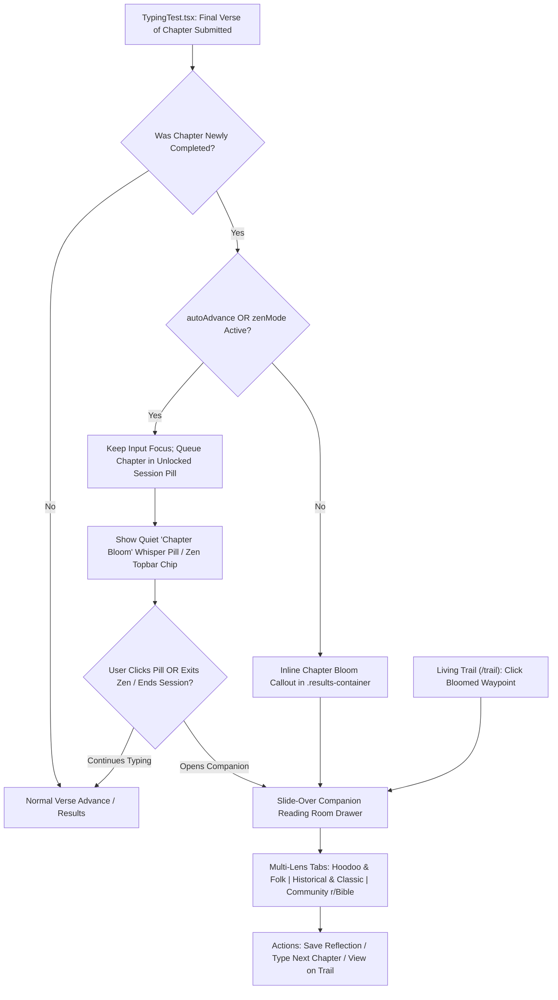

# Typing the Bible v3 — UX & Visual Direction Blueprint
## Living Pixel Trail & Post-Session Companion Reading Room

**Author:** Helia (UX Designer)  
**Target Release:** Typing the Bible v3 (Phase 1 Vertical Slice: Genesis + Psalms; architected for all 73 WEB Catholic canonical books and future `workId` texts)  
**Design System Anchor:** Editorial Atlas (`client/src/App.css`) — Parchment Light / Obsidian Dark, `Newsreader` · `DM Sans` · `JetBrains Mono`

---

## 1. Design Vision & Architectural North Star

Typing the Bible v3 weaves two soulful experiences into the existing **Editorial Atlas** workspace without compromising the quiet, tactile speed of the typing studio:

1. **The Living Trail (16-Bit Heritage World):** A Stardew Valley-inspired, internally authored 16-bit pixel trail where Michael's Black pixel traveler walks a winding pilgrimage path across biblical biomes infused with African-American & Hoodoo folkloric craft—rootwork gardens, drying herb bundles, brass porch lanterns, cedar altars, and red-clay roads. Unread chapters rest in soft parchment mist; completing a chapter blooms that waypoint into warm color and light.
2. **The Companion Reading Room (Post-Session Chapter Unlock Drawer):** A serene slide-over editorial drawer that celebrates chapter completion **after** typing rhythm settles—never interrupting Zen Mode or Auto-Advance—opening multi-lens study tabs (*Hoodoo & Folk*, *Historical & Classic*, and *Community `r/Bible`*).

### Core UX Principles
- **Editorial First, Never Arcade:** The 16-bit world is framed like an illuminated woodblock plate inside a finely printed Bible atlas—rectilinear `0px` corners, `1px solid var(--border-stone)` framing, `4px` terracotta/ochre accent rules, and generous breathing room. No neon HUDs, no XP popups, no bouncy cartoon chrome.
- **Sacred Flow Protection:** Typing focus in `TypingTest.tsx` (`autoAdvance`, `passageFlow`, `inlineTyping`, `zenMode`) is inviolable. Unlock celebrations whisper while typing and open on Michael's cadence.
- **100% Internal, Cohesive Art Pipeline:** Every tile, sprite, herb icon, and biome prop is generated internally on a locked 16-bit pixel grid and master color ramp. Never mix scraped web assets, inconsistent pixel densities, or generic stock icons.
- **Unapologetic Cultural Rootedness:** All human characters in the Living Trail are Black—rendered with dignity, warmth, and specificity rooted in Black Southern, Atlantic Diaspora, and Hoodoo craft traditions.

---

## 2. Visual Palette & 16-Bit Pixel-Art Harmonization Rules

### 2.1 Anchoring Pixel Art to `client/src/App.css` Tokens

Rather than dropping saturated SNES primaries onto the warm parchment UI, the 16-bit renderer derives its master palette directly from the existing `App.css` semantic tokens. Every scene supports both **Golden-Hour Daylight** (Light theme) and **Lantern Twilight** (Dark theme) via a **Dual Palette Lookup Table (LUT)** applied to indexed sprites/tiles—so one art asset automatically adapts when `ThemeToggle` switches schemes.

| Role | Light Theme (`Golden-Hour Daylight`) | Dark Theme (`Lantern Twilight`) | Existing `App.css` Anchor |
| :--- | :--- | :--- | :--- |
| **Canvas Frame / Paper Sky** | `#F5F3EE` / `#ECE8DF` | `#121214` / `#1A1A1D` | `--bg-parchment`, `--bg-bone` |
| **Mist / Dormant Veil** | `#DFDAD0` (75% opacity wash) | `#25252C` (78% opacity wash) | `--border-stone` / `--bg-bone` |
| **Trail Clay & Brick** | `#B84A39` · `#9E3B2B` · `#C98A6B` | `#9E4739` · `#E07A5F` · `#6E342A` | `--accent-terracotta`, `--accent-clay` |
| **Lantern & Brass Glow** | `#8A6A2F` · `#D4A359` · `#F2D28B` | `#D4A359` · `#F3C978` · `#FFF0C2` | `--accent-ochre` |
| **Living Water & Night Indigo** | `#345474` · `#527799` · `#8FB1C9` | `#23374D` · `#4A7094` · `#6D9DC5` | `--accent-slate-blue` |
| **Botanical Sage & Root Greens** | `#1F6E38` · `#3D7A4F` · `#7BA374` | `#1A4A2E` · `#2F7D4E` · `#4ADE80` | `--success-color` |
| **Rich Loam & Cedar Timber** | `#4A3426` · `#6E4E38` · `#8F6A4E` | `#2A1E17` · `#453124` · `#6B4C38` | Warm earth complement to `--ink-primary` |
| **Pixel Outline Ink** | `#1E1916` (warm espresso, never `#000`) | `#0D0C0E` (deep obsidian) | `--ink-primary` |

### 2.2 Locked 16-Bit Pixel Grid & Rendering Rules

| Rule | Specification | Rationale |
| :--- | :--- | :--- |
| **Base Tile Grid** | `16 × 16 px` logical tiles | Classic Stardew/GBA readability with rich botanical & architectural detail |
| **Human Character Grid** | `16 × 24 px` logical sprite (foot-anchored to tile bottom) | Allows natural posture, expressive hair silhouettes, lantern carry, and clear legibility over 16px paths |
| **Landmark Props** | `32 × 32 px` or `32 × 48 px` multi-tile stamps | Enough canvas for herb-drying racks, cedar arbors, stone wells, and glowing shrines |
| **Display Scaling** | Integer scale factors only (`2x`, `3x`, or `4x` via DPR-aware `<canvas>`) with `ctx.imageSmoothingEnabled = false` and CSS `image-rendering: pixelated` | Prevents blurry bilinear smears and mismatched "mixels" (mixed pixel sizes) |
| **Sprite Outline Rule** | Warm selective-outlining (`#1E1916` / `#4A3426` dark brown/indigo edges, never pure `#000000` black) | Keeps 16-bit art painterly and harmonious beside `Newsreader` serif ink |
| **Typography Separation** | **Never** use faux-pixel arcade fonts for UI copy or Bible text. Keep all labels, chapter numbers, and tooltips in `JetBrains Mono` / `DM Sans` / `Newsreader` | Preserves readability, accessibility, and the Editorial Atlas identity |
| **Surface Framing** | Trail viewport sits inside an editorial plate: `border: 1px solid var(--border-stone); border-inline-start: 4px solid var(--accent-ochre); background: var(--bg-ivory);` | Visually unites the pixel diorama with Dashboard charts and Typing Studio panels |
| **Zero External Scraping** | All tilesets & sprite sheets stored locally in `client/src/assets/trail/` (generated via deterministic pixel-atlas build scripts or authored pixel templates) | Guarantees CSP safety (`img-src 'self' data:`), offline reliability, and 100% cohesive art style |

---

## 3. Character & Cast Representation Specification

### 3.1 Universal Cast Policy
- **All human characters depicted anywhere in the Living Trail are Black.** This includes Michael's traveler avatar and every biome keeper, shepherd, root-elder, scribe, musician, and villager appearing across future biomes.
- **Skin-Tone Palette Discipline:** Use warm, dimensional 4-step melanin ramps with natural warm-amber highlights and deep umber shadows—never flat greyed-out brown or ashy desaturated tints:
  - *Deep Mahogany Ramp:* Shadow `#2D1810` → Base `#4E2A1B` → Mid `#6E3E28` → Warm Highlight `#8F573B`
  - *Rich Chestnut Ramp:* Shadow `#3F2114` → Base `#6B3B24` → Mid `#8E5234` → Warm Highlight `#B3714D`
  - *Warm Amber-Bronze Ramp:* Shadow `#56301B` → Base `#854F2E` → Mid `#AD6D43` → Warm Highlight `#CE8E5F`
- **Hair & Attire Authenticity:** Pixel silhouettes celebrate authentic Black textures (low fade, short twists, freeform locs, braided crown, headwraps/gele, linen tunics, indigo cloth, woven baskets, leather satchels, brass lanterns). Zero caricature or trope shortcuts.

### 3.2 Michael's Traveler Avatar (`traveler-michael`, `16 × 24 px`)
- **Appearance (Modern Traveler in a Timeless World):** Black man with Rich Chestnut/Deep Mahogany skin ramp and crisp low-fade haircut (with optional subtle beard pixel accent), dressed in **clean modern casual attire** that creates an intentional visual contrast against the historic Southern Hoodoo & biblical world: a warm terracotta-rust open modern overshirt or casual jacket (`#B84A39`) over a crisp ivory crewneck tee (`#ECE8DF`), dark slate tapered jeans (`#345474`), clean cream-and-terracotta sneakers, a sleek modern crossbody sling bag holding his journal, and a **brass lantern** (`#D4A359`) held in his lead hand when walking Twilight/Dark biomes.
- **World Contrast Rule:** Michael's avatar stays contemporary (modern everyday clothes), while biome keepers, elders, architecture, flora, and biblical landmarks remain timeless/historic Southern African-American & Hoodoo craft—creating a "modern reader stepping into living scripture" narrative.
- **Animation States (4-frame loops at `180ms/frame` when motion allowed):**
  1. `idle`: Subtle breathing rise (`1px` torso shift) + gentle lantern sway.
  2. `walk-east / walk-west / walk-north / walk-south`: Smooth 4-frame stride along Bezier trail splines between chapter stones.
  3. `pause-read`: Traveler pauses beside a newly bloomed chapter waypoint, opens a tiny ivory book with a golden sparkle above it.
  4. `lantern-raise` (Chapter Bloom milestone): Brief 3-frame lantern lift that sends a warm ochre radial pulse across the clearing.

### 3.3 Phase 1 Biome Cast (NPCs / Keepers)
Keepers are quiet ambient figures who appear once a biome's landmark blooms (never noisy RPG quest-givers):
- **Genesis — *The Garden Root-Keeper* (`16 × 24 px`):** Black woman elder in an ochre headwrap and sage apron tending raised cedar herb beds and watering budding fig/john-the-conqueror roots at the Eden clearing.
- **Psalms — *The Twilight Psalmist* (`16 × 24 px`):** Black elder seated on a timber porch beside hanging drying bundles of hyssop, lavender, and rosemary, softly plucking a wooden harp/lyre under warm amber porch lanterns.

---

## 4. Biome & Landmark Progression States

### 4.1 Chapter Waypoint State Machine

Every chapter in a book is a tactile waypoint stone/lantern along the winding biome trail. Its state derives directly from existing completion math (`chapterCompleted` vs `chapterTotal` from `Progress` rollups):

| State | Completion Rule | Visual Treatment on Trail | Interactive Affordance |
| :--- | :--- | :--- | :--- |
| **1. Locked / Dormant (Mist)** | `chapterCompleted === 0` | Low-contrast parchment/obsidian stone marker veiled in soft pixel mist (`--bg-bone` / `#DFDAD0` light, `#25252C` dark). Bare branches, unlit brass lantern, monochrome sepia-stone tint. | Click opens compact popover: *"Genesis 4 · 0/26 verses · Dormant — Start typing to bloom this clearing & unlock Companion notes."* CTA: `Type Chapter 4 →` |
| **2. In-Progress (Kindling)** | `0 < chapterCompleted < chapterTotal` | Mist pulls back in a partial clearing; warm ember glows inside the lantern; a crisp 16-bit mini progress ring/bar (`--accent-ochre`) sits beneath the stone; sprouts emerge around the trail edge. Michael's traveler stands at the most recently active node. | Click opens popover showing `14 / 26 verses (53.8%)` + CTA `Continue Typing (v. 15) →`. Companion lenses show *"Unlocks upon chapter completion (12 verses left)"*. |
| **3. Bloomed (Completed)** | `chapterCompleted >= chapterTotal` | Full-color pixel biome tile blooms around the waypoint: lush botanical sage, terracotta blossoms, golden brass lantern halo (`#D4A359`), drying herbs & fireflies (in Dark mode). Small `✦` brass seal marks unlocked Companion commentary. | Click opens popover with dual CTAs: Primary `Open Companion Reading Room` (`✦ 3 Lenses`) + Secondary `Re-type Chapter`. |
| **4. Book Mastery (Sanctuary Radiance)** | All chapters in book completed | The Biome's central Hero Landmark (e.g., Eden Tree of Roots, Shepherd's Sanctuary Porch) illuminates permanently; the Biome Keeper appears; a subtle golden border accent adorns the biome crest on the Atlas overview. | Celebrated on the Atlas overview and linked directly to the Book's Companion Index. |

### 4.2 Macro Atlas Regions (Scalable 73-Book Vision)

The Living Trail scales cleanly across the full 73-book Catholic WEB canon by grouping books into **9 cohesive Stardew-meets-Hoodoo visual regions** (aligned with canonical book order in `client/src/data/books.ts`):

| # | Region / Biome | Books Included | Signature Visual Palette & Heritage Motif | Phase |
| :---: | :--- | :--- | :--- | :---: |
| 1 | **Eden Root-Garden & Covenant Plains** | Pentateuch (Gen–Deut) | Red-clay garden paths, cedar herb beds, fig & pomegranate trees, brass watering can, stone altar | **Phase 1 (Genesis)** |
| 2 | **Red-Clay Kingdoms & Watchtowers** | Historical (Josh–2 Chr, Ezra–Neh) | Terracotta masonry, timber gates, harvest fields, hearth smoke | Phase 2 |
| 3 | **Twilight Shepherd's Sanctuary** | Psalms | Indigo twilight sky, mossy stone pasture, timber apothecary porch, hanging drying herbs (hyssop, bay, lavender), glowing porch lanterns, still slate-blue creek | **Phase 1 (Psalms)** |
| 4 | **Elder's Timber Study & Spice Market** | Wisdom (Job, Prov, Eccl, Song, Wis, Sir) | Warm cedar bookshelves, brass scales, spice jars, candlelit porch | Phase 2 |
| 5 | **Watchman's Ridge & Ember Hills** | Major Prophets (Isa–Dan, Bar) | Ochre mesas, signal braziers, weathered stone scrolls | Phase 2 |
| 6 | **Crossroads Lanterns** | Minor Prophets (Hos–Mal) | Winding crossroads signs, iron lanterns, wildflower verge | Phase 2 |
| 7 | **Deuterocanonical Lantern Groves** | Tobit, Judith, Esther, 1–2 Macc | Olive groves, braided rivers, courtyard lamps, crimson textiles | Phase 2 |
| 8 | **Galilean Harbor & Cypress Roads** | Gospels & Acts | Slate-blue harbor water, wooden boats, limestone docks, coastal olive trees | Phase 3 |
| 9 | **Epistle Post-Roads & Starlit City** | Epistles & Revelation | Lantern-lit cobbled post-roads, cedar writing desks, golden starlit pavilion | Phase 3 |

### 4.3 Solving Scale: Two-Tier Zoom for Long Books (Genesis 50 & Psalms 150)

Rendering 150 Psalm waypoints on a single screen creates clutter and tiny inaccessible click targets. The Living Trail uses a **2-Tier Spatial Hierarchy**:

1. **Tier 1 — Atlas Trail Strip (Macro View):** Horizontal scrollable biome cards showing Michael's traveler pinned to his current active biome, overall bloom count (e.g., `Psalms · 12 / 150 Chapters Bloomed`), and a compact 16-bit preview diorama.
2. **Tier 2 — Biome Clearing (Playable Chapter Trail):** Selecting a biome opens its full 16-bit winding path organized into **digestible Trail Legs of 10–15 chapters per clearing**:
   - **Genesis (50 chapters):** 5 Trail Legs (`Ch. 1–10`, `Ch. 11–20`, `Ch. 21–30`, `Ch. 31–40`, `Ch. 41–50`).
   - **Psalms (150 chapters):** Grouped naturally into the **5 Classical Books of the Psalter** (`Book I: 1–41`, `Book II: 42–72`, `Book III: 73–89`, `Book IV: 90–106`, `Book V: 107–150`), each subdivided into scenic clearings of 10–14 lantern posts.
   - **Quick-Jump Bar above the Canvas:** `[Next Active]` · `[Bloomed Only (N)]` · `[Book/Leg Selector]` · `[Accessible List View toggle]`.

---

## 5. Post-Session Unlock Trigger & Companion Drawer Wireflow

### 5.1 Protecting Zen Mode & Auto-Advance Flow

In `TypingTest.tsx`, finishing a verse when `autoAdvance === true` immediately clears `typedText` and fetches the next verse while keeping `.typing-input-inline` focused. When that finished verse also completes the chapter (`chapterCompleted === chapterTotal` and the chapter was not previously unlocked in this session):

- **Rule 1 — Never Steal Focus Mid-Flow:** When `autoAdvance` OR `zenMode` is enabled, the Companion Drawer **never auto-opens** and **never moves keyboard focus** out of `.typing-input-inline`.
- **Rule 2 — The Quiet "Chapter Bloom" Whisper Pill:**
  - In standard mode (`autoAdvance=true`, `zenMode=false`): A warm ochre-accented editorial pill appears seamlessly in the status slot alongside `.last-completed-banner`:  
    `[16px bloomed herb icon] Psalm 23 Bloomed · Companion Unlocked` — `[Open Reading Room]` `[Dismiss ×]`
  - In `zenMode=true`: A minimalist mono chip quietly fades into `.zen-topbar` beside `Exit Zen (Esc)`:  
    `✦ Psalm 23 Unlocked (1)` — clicking it or pressing `Exit Zen` reveals the Reading Room at Michael's pace.
- **Rule 3 — Unread Unlock Queue (Post-Session Catch-Up):** If Michael types straight through 3 chapters in a single Zen/Auto-Advance streak, each newly bloomed chapter queues into a subtle session counter (`✦ 3 Chapters Unlocked This Session`). When Michael stops typing, clicks the pill, exits Zen Mode, or switches to a single-verse completion screen, a compact **Session Harvest Strip** offers one-click entry into any unlocked chapter's Companion Drawer.
- **Rule 4 — Non-Auto-Advance Completion:** When `autoAdvance === false` and `!zenMode`, the existing `.results-container` ("Verse Completed!") displays an inline **Chapter Bloom Banner** (`border-inline-start: 4px solid var(--accent-ochre)`) with `Open Companion Reading Room` and `View on Living Trail`.

### 5.2 End-to-End Interaction Wireflow



### 5.3 Companion Reading Room Drawer Layout & Wireframe

The Companion Reading Room is a reusable slide-over drawer (`<CompanionDrawer />`) invocable from **`/typing`**, **`/trail`**, and **`/dashboard` (Book Coverage)**—preserving context underneath with a subtle `rgba(20, 20, 19, 0.42)` backdrop scrim.

```text
+-------------------------------------------------------------------+
| [16px Biome Crest]  COMPANION READING ROOM · WEB          [Esc ×] |
| Psalm 23 — Twilight Shepherd's Sanctuary                          |
| Bloomed Nov 19 · 6/6 verses · Best 74 WPM · 99% Acc               |
+-------------------------------------------------------------------+
| [ Hoodoo & Folk ]  [ Historical & Classic ]  [ Community r/Bible ]|
+-------------------------------------------------------------------+
|  LENS KICKER (JetBrains Mono, uppercase, --accent-ochre)          |
|  TRADITIONAL ROOTWORK & FOLKLORIC PRACTICE                        |
|                                                                   |
|  Editorial Title (Newsreader, 1.35rem)                            |
|  "For Guidance, Protection & Peaceful Crossing"                   |
|                                                                   |
|  Body Copy (Newsreader / DM Sans, 1.02rem, line-height 1.72,      |
|  max-width 62ch for effortless long-form reading)                 |
|  ...curated excerpt / structured summary with clear attribution... |
|                                                                   |
|  +--- SOURCE & TRADITION ATTRIBUTION BOX (bg-parchment) --------+ |
|  | Primary Source: Anna Riva, Power of the Psalms (Personal PDF)| |
|  | Folkloric Echo: Zora Neale Hurston, Mules and Men (1935)     | |
|  | Traditional Pairing: Hyssop · Olive Oil · White Candle       | |
|  +--------------------------------------------------------------+ |
+-------------------------------------------------------------------+
| [← Prev Chapter]   [View on Living Trail]   [Type Psalm 24 →]     |
+-------------------------------------------------------------------+
```

#### Drawer Sizing & Responsive Behavior
- **Desktop (`>= 960px`):** Right-anchored editorial sheet, `width: min(560px, 46vw)`, full viewport height, `background: var(--bg-ivory)`, `border-inline-start: 1px solid var(--border-strong)`, subtle left shadow.
- **Tablet (`600px – 959px`):** `width: min(520px, 88vw)`.
- **Mobile (`< 600px`):** Full-width bottom/full sheet (`100vw`, `max-height: 92dvh`) with sticky top header and sticky tab bar so lens switching remains thumb-reachable.

#### Multi-Lens Tab Specification
All tabs implement ARIA `role="tablist"`, `role="tab"`, `role="tabpanel"` with Left/Right arrow navigation:

1. **Tab 1 — `Hoodoo & Folk`** (Accent: `--accent-ochre` `#8A6A2F` / `#D4A359`)
   - Features traditional African-American spiritual, conjure, and Hoodoo uses of the chapter (e.g., Anna Riva's *Power of the Psalms* personal library import, Zora Neale Hurston's folkloric context from *Mules and Men* and *Tell My Horse*).
   - Displays structured editorial metadata pills where available: **Intent / Purpose**, **Traditional Botanicals / Elements**, **Source Citation**.
   - *Graceful Empty State (for chapters outside Psalms/Genesis folklore):* Never show a broken tab. Display a warm editorial note: *"No Hoodoo & Folk entry curated for [Book Ch.] yet — switch to Historical & Classic, or add a personal study note."*
2. **Tab 2 — `Historical & Classic`** (Accent: `--accent-slate-blue` `#345474` / `#6D9DC5`)
   - Public-domain biblical scholarship covering all 73 books including Deuterocanonicals (e.g., Haydock Catholic Bible Commentary, 1913 Catholic Encyclopedia, Spurgeon's *Treasury of David* for Psalms, Matthew Henry).
   - Clean structured layout: **Historical Setting**, **Key Commentary Excerpt**, **Public-Domain Source Attribution**.
3. **Tab 3 — `Community r/Bible`** (Accent: `--accent-terracotta` `#B84A39` / `#E07A5F`)
   - Offline-curated community discussion highlights (paraphrased themes + attributed discussion threads imported via CLI, zero live scraping in the browser).
   - Structured cards: **Reader Question / Theme**, **Community Takeaway**, **Curated Reference Link & Date**.
   - *Graceful Empty State:* *"No community highlights archived for [Book Ch.] yet."*

#### `workId` Future Extensibility in UI
- The drawer header renders a subtle `workId` kicker badge when viewing non-default works (hidden or shown as `WEB · CANON` for Bible chapters; dynamically displays work title/author when future books are imported), keeping the component contract work-agnostic (`{ workId, book, chapter }`).

#### Keyboard `Escape` Precedence (Critical for `TypingTest.tsx`)
1. If `<CompanionDrawer />` is open → `Escape` closes the drawer and restores focus to the opener button (or returns cleanly to the typing canvas), **without** exiting Zen Mode.
2. If `<CompanionDrawer />` is closed and `zenMode` is active → `Escape` exits Zen Mode (preserving existing `TypingTest.tsx` behavior).

---

## 6. Accessibility, Contrast & Reduced-Motion Rules

| Area | Requirement | Implementation Detail |
| :--- | :--- | :--- |
| **Keyboard Trail Navigation** | Every waypoint on the Living Trail is keyboard-reachable without mouse precision. | Render an interactive **DOM overlay layer** of semantic `<button>` nodes aligned directly over the `<canvas>` waypoints using roving `tabindex` (Arrow keys step along the trail; `Enter`/`Space` opens the waypoint popover). |
| **Non-Visual / Table Alternative (NFR-2)** | Matches existing `BookCoverage.tsx` accessibility bar. | Provide a one-click **`Accessible Chapter List`** toggle right in the Trail toolbar (plus semantic `aria-label` on the canvas) rendering a clean filterable list/table of chapters with exact status (`Dormant`, `In Progress 14/26`, `Bloomed · Companion Ready`) and direct `Type` / `Read Companion` links. |
| **Reduced Motion (`prefers-reduced-motion: reduce`)** | Zero continuous pixel animation, drifting mist, lantern flicker, or slide transitions when reduced motion is preferred. | Freeze traveler sprite on crisp static `idle` frame 0; replace walk interpolation with instant node placement + subtle `opacity` crossfade (`150ms`); disable firefly/mist drift and bloom wipes; open Companion Drawer instantaneously without slide animation. |
| **Color & Contrast (WCAG 2.1 AA)** | All UI text, badges, and waypoint labels meet `>= 4.5:1` contrast in both Light and Dark themes; status is never communicated by color alone. | Combine color with distinct shape/icon states: **Dormant** = dashed stone outline + lock/mist glyph, **In-Progress** = half-filled ring + verse fraction, **Bloomed** = solid brass seal + `✦` glyph. Honor `@media (forced-colors: active)` with `CanvasText` / `Highlight` borders. |
| **Screen Reader Announcements** | Announce unlocks politely without disrupting active typing. | Use a single `aria-live="polite" aria-atomic="true"` region for Chapter Bloom whisper pills; never use `aria-live="assertive"` during typing. |
| **Drawer Focus Management** | Full modal/dialog accessibility when Companion Reading Room opens. | Use native `<dialog>` or `role="dialog" aria-modal="true" aria-labelledby`; trap focus inside drawer while open; return focus to invoking control on close. |
| **CSP & Asset Safety** | Zero inline script edits (`client/public/index.html` untouched); zero external image URLs. | Bundle sprite sheets/tilesets locally in `client/src/assets/trail/` or generate programmatically onto `<canvas>` so Helmet CSP remains 100% intact. |

---

## 7. Phase 1 Vertical Slice: Genesis + Psalms Playable Trail & Drawer

To ship value rapidly while validating both the 16-bit aesthetic and the multi-lens Companion experience end-to-end, Phase 1 focuses exclusively on **Genesis (50 chapters)** and **Psalms (150 chapters)**—the two books with the richest initial Hoodoo/Folk + Historical commentary—with the remaining 71 books visible as mist-veiled future horizons on the Atlas overview.

### 7.1 Navigation & Entry Points
- **New Top-Level Route:** `/trail` (`Living Trail`), added to `Navbar.tsx` between `Memory & Plans` and `Dashboard` (desktop & mobile menu) for signed-in users.
- **Home Page (`Home.tsx`):** Add a warm feature card ("Living Trail & Companion") linking directly to `/trail`.
- **Dashboard (`Dashboard.tsx` / `BookCoverage.tsx`):** Add a subtle `✦ View on Trail` link next to Genesis and Psalms rows, plus a `✦ Companion` chip for completed chapters.
- **Typing Studio (`TypingTest.tsx`):** Non-intrusive Chapter Bloom whisper pill + Zen topbar chip + `<CompanionDrawer />` mounted right inside `/typing`.

### 7.2 Minimal Phase 1 Asset Manifest (Internally Authored)
Keeping Phase 1 lean guarantees cohesive art quality without an asset bottleneck:

| Asset | Dimensions | Frames / Variants | Notes |
| :--- | :--- | :--- | :--- |
| `traveler-michael.png` (or indexed JSON atlas) | `16 × 24 px` per frame | 10 frames (idle ×2, walk-side ×4, walk-up/down ×2, lantern-raise ×2) | Black male traveler with Daylight + Twilight LUT palette swap |
| `keepers-phase1.png` | `16 × 24 px` per frame | 4 frames (Genesis Root-Keeper ×2, Psalms Twilight Psalmist ×2) | Appears on biome hero landmarks upon bloom |
| `terrain-tiles-phase1.png` | `16 × 16 px` per tile | 24 tiles (red clay path, mossy stone path, grass/sage, twilight creek water, garden soil, mist veil ×4, wooden fence, cedar deck) | Shared ground kit across Genesis & Psalms with LUT tinting |
| `landmarks-phase1.png` | `32 × 32 px` props | 10 stamps (Eden Tree dormant/bloomed, Cedar Herb Bed, Hanging Drying Herbs, Brass Porch Lantern unlit/lit, Shepherd's Sanctuary Porch, Stone Waypoint dormant/kindling/bloomed) | Anchors each clearing's visual identity |
| `lens-micro-icons.svg` | `16 × 16 px` pixel-crisp SVG | 3 icons (Herb Sprig = Hoodoo & Folk, Open Codex = Historical & Classic, Lantern Circle = Community `r/Bible`) | Used in Companion Drawer tabs & Whisper Pills |

### 7.3 Phase 1 Component Hierarchy & Integration Contract

```text
client/src/components/
├── trail/
│   ├── LivingTrailPage.tsx         # /trail route: Atlas strip + active Biome Clearing + List fallback
│   ├── BiomeCanvas.tsx             # DPR-aware 16-bit <canvas> renderer (Daylight/Twilight LUT)
│   ├── WaypointOverlay.tsx         # Accessible keyboard-navigable button layer + chapter popover
│   ├── TrailChapterList.tsx        # NFR-2 accessible table/list fallback
│   └── trailPalette.ts             # Harmonized Editorial Atlas <-> 16-bit LUT color definitions
└── companion/
    ├── CompanionDrawer.tsx         # Slide-over Reading Room (Esc handling, focus trap, 3 tabs)
    ├── CompanionLensPanel.tsx      # Renders Hoodoo/Historical/Community entries + graceful empty state
    └── ChapterBloomToast.tsx       # Quiet whisper pill & Zen topbar chip for TypingTest.tsx
```

**Expected Client Data Contracts (aligned with `workId` extensibility):**
- `GET /api/trail/progress?workId=web-catholic&book=Psalms` → per-chapter `{ chapter, totalVerses, completedVerses, state: 'dormant' | 'in_progress' | 'bloomed', hasCompanion, bestWpm, bestAccuracy, unlockedAt }`.
- `GET /api/companion/:book/:chapter?workId=web-catholic` → `{ workId, book, chapter, unlocked, lenses: { hoodoo_folk?: CompanionEntry[], historical_classic?: CompanionEntry[], community_reddit?: CompanionEntry[] } }` (returns `unlocked: false` with teaser metadata if chapter is incomplete).
- `POST /api/progress/result/:verseId` → existing response augmented with optional `chapterJustUnlocked?: { book, chapter, totalVerses }` so `TypingTest.tsx` triggers the Chapter Bloom whisper pill accurately with zero extra polling.

### 7.4 Phase 1 UX Acceptance Criteria
1. **Zero Flow Disruption:** Completing the final verse of Genesis 1 or Psalm 23 with `autoAdvance=true` or `zenMode=true` advances seamlessly to the next verse while keeping keyboard focus locked inside `.typing-input-inline` and surfacing the quiet Chapter Bloom whisper pill.
2. **Instant Theme Cohesion:** Toggling `ThemeToggle` between Light and Dark transitions the 16-bit Living Trail cleanly between *Golden-Hour Daylight* and *Lantern Twilight* with zero broken contrast or harsh white boxes.
3. **Playable Two-Biome Trail:** Both **Genesis** (5 legs of 10 chapters) and **Psalms** (5 Books of the Psalter divided into scenic clearings) render Michael's Black traveler avatar positioned at the active chapter, visually distinguish Dormant / In-Progress / Bloomed nodes, and route directly to `/typing?book=...&chapter=...` or open `<CompanionDrawer />`.
4. **Authentic Representation:** All human sprites rendered in Phase 1 (Michael + Genesis Root-Keeper + Psalms Twilight Psalmist) follow the melanin palette ramps and cultural craft spec in Section 3.
5. **Multi-Lens Reading Room:** Clicking any bloomed Genesis or Psalms chapter opens `<CompanionDrawer />` with keyboard-accessible tabs for *Hoodoo & Folk*, *Historical & Classic*, and *Community `r/Bible`*, clean source citations, and graceful empty states for lenses without entries.
6. **Accessible & Reduced-Motion Verified:** Full keyboard traversal across trail waypoints, one-click `Accessible Chapter List` alternative, proper `Escape` precedence with Zen Mode, and zero continuous motion under `prefers-reduced-motion: reduce`.
